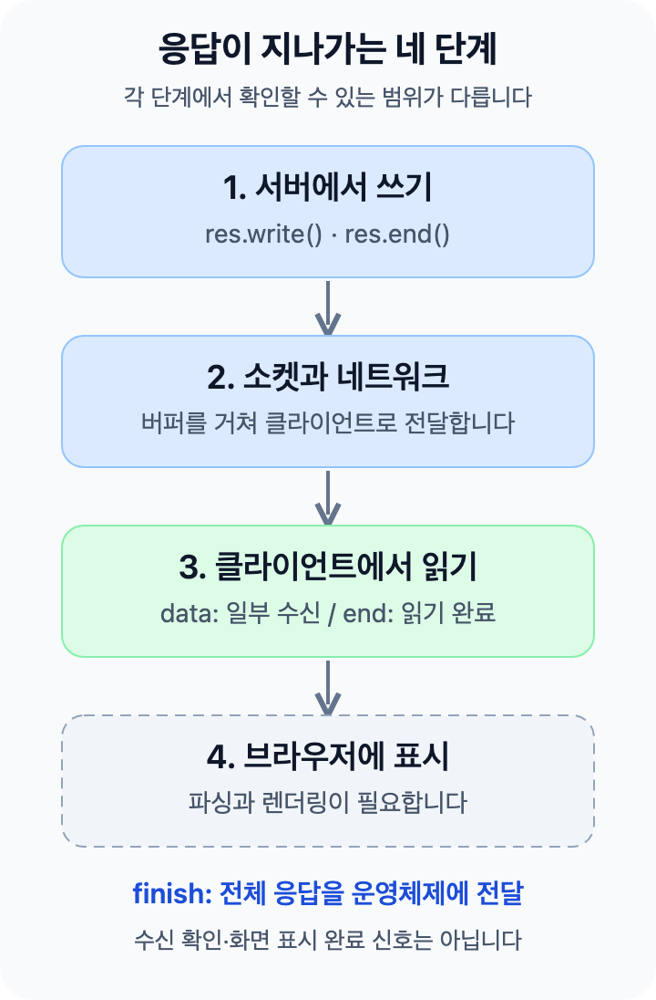
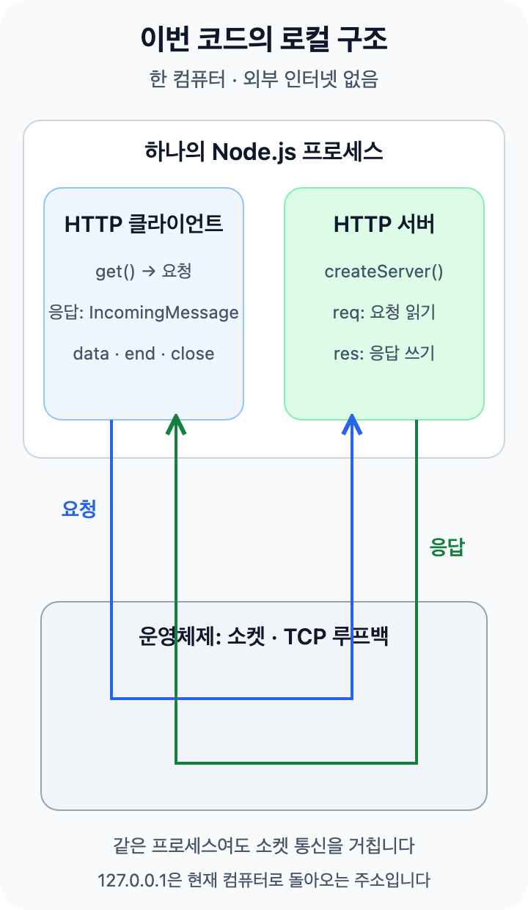
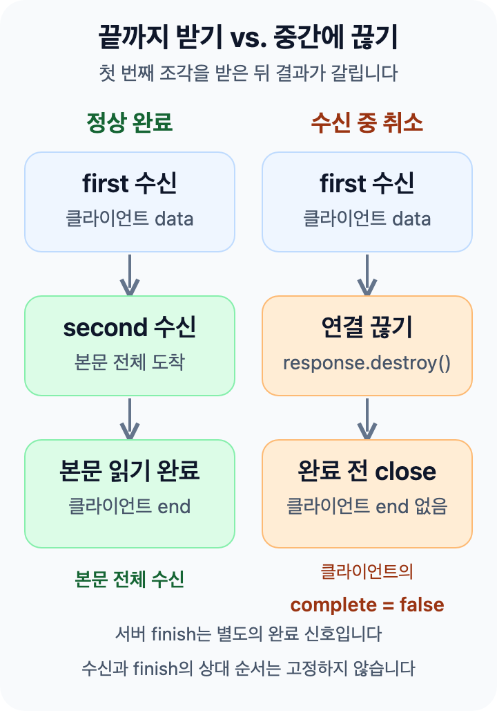
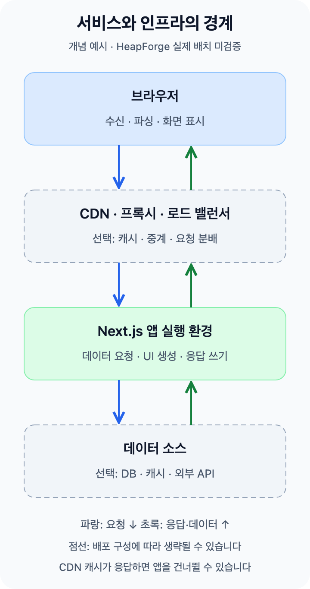

## 보냈다는 로그와 화면 표시는 다릅니다

서버에서 `write()`를 호출했다고 클라이언트가 바로 받은 것은 아닙니다. **쓰기 → 전송 → 수신 → 화면 표시**는 서로 다른 단계입니다.



이번에는 Node.js 서버와 클라이언트를 한 파일에서 실행해 **수신까지** 관찰하겠습니다. 브라우저 표시는 이 실험의 범위 밖입니다. 백프레셔가 궁금하시면 [이전 글](/ko/docs/category/be/node-js/stream-backpressure-diagnosis)을 먼저 읽어 주세요.

## 먼저 알아둘 용어

| 용어         | 의미                                                                                                                          |
| ------------ | ----------------------------------------------------------------------------------------------------------------------------- |
| HTTP 응답    | 상태 코드·헤더·본문으로 이루어진 서버의 답입니다.                                                                             |
| 헤더         | 본문의 종류 같은 부가 정보입니다. `Content-Type`이 여기에 속합니다.                                                           |
| 청크(chunk)  | 스트림에서 나누어 쓰거나 읽는 데이터 조각입니다.                                                                              |
| 소켓(socket) | 프로그램이 네트워크 연결을 사용하는 통신 끝점입니다.                                                                          |
| `req`        | 서버에서 요청을 읽는 `IncomingMessage` 객체입니다. Readable, 즉 읽기 스트림입니다.                                            |
| `res`        | 응답을 쓰는 `ServerResponse` 객체입니다. Writable의 쓰기 API를 사용합니다. `stream.Writable`을 직접 상속하는 객체는 아닙니다. |

클라이언트의 `get()` 콜백도 `IncomingMessage`를 받지만, 이쪽에서는 **응답**을 읽습니다.

## 이번 실험의 서비스 구조



프로그램 하나가 **클라이언트와 서버 두 역할**을 맡습니다. 같은 프로세스에 있어도 직접 함수를 호출해 본문을 건네지 않고, 소켓과 운영체제의 루프백(loopback)을 거칩니다. 루프백은 외부 인터넷으로 나가지 않고 현재 컴퓨터로 돌아오는 통신입니다.

HTTP 계층이 요청 헤더를 해석하면 `createServer()`에 등록한 함수가 호출됩니다. 요청 본문은 이후에도 `req` 스트림으로 들어올 수 있으며, 함수는 `res`로 응답을 씁니다.

여기에는 브라우저·CDN·외부 API가 없습니다. 양쪽 로그는 같은 프로세스의 시계를 사용하므로, 여러 서버의 시계를 맞추는 문제까지 검증한 것은 아닙니다.

<details>
<summary>한 단계 더: 운영체제 안에서는 무슨 일이 일어날까요?</summary>

커널은 운영체제에서 네트워크·메모리 등을 관리하는 핵심 부분입니다. 버퍼는 데이터를 다음 단계가 처리할 때까지 잠시 보관하는 메모리입니다.

| 단계      | 하는 일                                                                                                                                               |
| --------- | ----------------------------------------------------------------------------------------------------------------------------------------------------- |
| 연결      | 서버가 연결을 기다리고, 클라이언트와 TCP 연결을 만듭니다. 서버의 대기 소켓과 실제 통신하는 연결 소켓은 구분됩니다.                                    |
| 송신      | Node.js가 HTTP 요청을 바이트로 구성하고 운영체제에 쓰기를 요청합니다. Node.js 내부 버퍼와 커널의 송신 버퍼는 별개입니다.                              |
| 전달      | TCP가 순서·수신 확인 등을 관리하며 루프백 경로로 데이터를 전달합니다. 외부 인터넷으로 나가지 않습니다.                                                |
| 수신 대기 | 데이터가 서버 소켓의 수신 버퍼에서 프로그램이 읽기를 기다릴 수 있습니다.                                                                              |
| 읽기·해석 | Node.js가 운영체제에서 소켓 데이터를 읽고 HTTP 요청을 해석합니다. 헤더를 해석하면 서버 요청 처리 함수가 실행되며, 본문은 이후에도 들어올 수 있습니다. |

커널이 JavaScript 함수를 직접 호출하는 것은 아닙니다. Node.js가 운영체제의 입출력 기능을 사용해 읽고, HTTP 요청을 해석한 뒤 요청 처리 함수를 실행합니다. 긴 JavaScript 계산 중에는 같은 프로세스의 타이머·수신 콜백이 실행되지 못할 수 있습니다.

**TCP의 수신 확인(ACK), 서버의 `finish`, 클라이언트의 `data`는 서로 다른 층의 신호입니다.** ACK는 JavaScript의 요청 처리 완료를 뜻하지 않습니다. 쓰기 두 번과 `data` 두 번도 일대일로 대응한다고 보장할 수 없습니다.

이번 HTTP 실험은 애플리케이션 로그를 관측합니다. 커널 버퍼 크기·패킷 수·ACK 시각은 측정하지 않았습니다. 별도 소켓 실험에서는 양쪽 주소·포트와 운영체제의 소켓 목록을 확인했습니다. 2026-10-11의 별도 TCP 실험에서는 수신 프로세스의 CPU 작업이 없을 때와 200ms 동안 계산할 때를 각각 3회 비교했습니다. 타이머 지연과 계산 종료 뒤 수신 콜백 실행을 관측했으며, 이 글의 HTTP 예제에서 측정한 결과는 아닙니다. 버퍼 정량 비교와 Next.js 화면 표시 비교 실험은 아직 실행하지 않았습니다.

참고: [libuv 입출력 설계](https://docs.libuv.org/en/v1.x/design.html#the-i-o-loop), [TCP 바이트 흐름](https://www.rfc-editor.org/rfc/rfc9293.html#section-3.7).

</details>

## 두 조각으로 보내고 직접 확인해 보세요

Node.js 24에서 아래 **정상 1~5번 코드 블록 안의 내용만 위에서 아래 순서로 복사해 하나의 `http-response-streaming.mts` 파일에 붙여 주세요.** 각 블록을 따로 실행하지 않습니다. `.mts`는 ES 모듈 형식의 TypeScript 파일입니다. Node.js는 타입 표기를 제거해 실행하며, 타입 검사는 별도입니다.

서버는 `first`를 먼저 쓰고 약 300ms 뒤 `second`로 응답을 마칩니다. 클라이언트는 받은 내용을 출력합니다. `127.0.0.1`은 현재 컴퓨터를 가리키는 주소이며, 포트 `0`은 사용 가능한 포트를 골라 달라는 뜻입니다.

### 정상 1/5 — 준비와 시간 기록

양쪽 로그에 같은 시계를 사용합니다.

```ts filename="http-response-streaming.mts" part="1/5"
import assert from 'node:assert/strict'
import { once } from 'node:events'
import { createServer, get, type IncomingMessage } from 'node:http'
import { performance } from 'node:perf_hooks'

const startedAt = performance.now()
function log(message: string): void {
    const elapsed = Math.round(performance.now() - startedAt)
    console.log(`${elapsed}ms ${message}`)
}
```

### 정상 2/5 — 응답을 만드는 서버

요청이 들어오면 첫 조각을 쓰고, 타이머로 다음 조각을 예약합니다. `setTimeout()`은 다음 작업을 예약하므로 그동안 수신 콜백도 실행할 수 있습니다.

```ts filename="http-response-streaming.mts" part="2/5"
const server = createServer((req, res) => {
    req.resume()
    res.on('finish', () => log('server finish'))
    res.on('close', () => {
        log(`server close writableFinished=${res.writableFinished}`)
    })
    res.on('error', (error: Error) => log(`server error: ${error.message}`))

    res.writeHead(200, { 'Content-Type': 'text/plain; charset=utf-8' })
    const canContinue = res.write('first\n')
    log(`server write first: ${canContinue}`)
    const timer = setTimeout(() => {
        log('server end second')
        res.end('second\n')
    }, 300)
    res.once('close', () => clearTimeout(timer))
})
```

### 정상 3/5 — 받은 본문을 검사하는 함수

`data`로 받은 조각을 모으고 `end`에서 최종 본문을 검사합니다. `Promise<void>`는 이 비동기 작업의 완료나 실패를 나타내며, 완료될 때 별도 값을 반환하지 않습니다.

```ts filename="http-response-streaming.mts" part="3/5"
function readResponse(response: IncomingMessage): Promise<void> {
    log(`client status: ${response.statusCode}`)
    response.setEncoding('utf8')
    return new Promise((resolve, reject) => {
        let body = ''
        response.on('data', (chunk: string) => {
            body += chunk
            log(`client data: ${JSON.stringify(chunk)}`)
        })
        response.once('error', reject)
        response.once('end', () => {
            log('client end')
            try {
                assert.equal(response.statusCode, 200)
                assert.equal(body, 'first\nsecond\n')
                resolve()
            } catch (error) {
                reject(error)
            }
        })
    })
}
```

### 정상 4/5 — 요청을 보내는 함수

응답 객체가 생기면 앞의 수신 함수에 넘깁니다. 오류와 5초 동안의 통신 비활동을 처리합니다.

```ts filename="http-response-streaming.mts" part="4/5"
function requestResponse(port: number): Promise<void> {
    return new Promise((resolve, reject) => {
        const request = get(
            { hostname: '127.0.0.1', port, path: '/', agent: false },
            (response) => {
                readResponse(response).then(resolve, reject)
            }
        )
        request.once('error', reject)
        request.setTimeout(5000, () => {
            request.destroy(new Error('request timeout'))
        })
    })
}
```

### 정상 5/5 — 시작부터 정리까지

서버가 준비된 뒤 요청합니다. 성공하거나 실패해도 서버와 남은 연결을 닫습니다.

```ts filename="http-response-streaming.mts" part="5/5"
server.listen(0, '127.0.0.1')
await once(server, 'listening')
const address = server.address()
assert.ok(address && typeof address !== 'string')

try {
    await requestResponse(address.port)
} finally {
    await new Promise<void>((resolve, reject) => {
        server.close((error) => (error ? reject(error) : resolve()))
        server.closeAllConnections()
    })
}
```

```bash
node http-response-streaming.mts
```

2026-10-08, Node.js v24.12.0에서 관측한 로그입니다. 시간과 세부 이벤트 순서는 실행마다 달라질 수 있습니다.

```text
22ms server write first: true
23ms client status: 200
24ms client data: "first\n"
323ms server end second
325ms server finish
325ms server close writableFinished=true
326ms client data: "second\n"
326ms client end
```

첫 본문을 **응답이 끝나기 전에** 읽었습니다. 서버의 `finish`는 클라이언트의 두 번째 수신보다 먼저 기록됐지만, 모든 환경에서 이 순서를 보장하지는 않습니다.

| 관측              | 의미                                                                      |
| ----------------- | ------------------------------------------------------------------------- |
| 서버 `write()`    | 본문 쓰기. 반환값은 계속 써도 되는지 알려 주며 수신 완료 신호는 아닙니다. |
| 서버 `end(data)`  | 마지막 본문을 쓰고 이번 응답을 마칩니다. 연결 자체의 종료와는 다릅니다.   |
| 서버 `finish`     | 데이터를 운영체제에 모두 넘겼습니다. 상대 수신은 보장하지 않습니다.       |
| 클라이언트 `data` | 데이터를 읽었습니다. `write()`와 일대일 대응하지 않을 수 있습니다.        |
| 클라이언트 `end`  | 본문 읽기가 끝났습니다. 화면 표시 완료는 아닙니다.                        |

`write() === false`여도 데이터가 거절된 것은 아닙니다. 추가 쓰기를 멈추고 `drain`을 기다리라는 백프레셔 신호입니다. 이번 예제에서는 백프레셔가 발생할 만큼 큰 데이터를 쓰지 않습니다.

<details>
<summary>코드의 보조 기능 알아보기</summary>

- `req.resume()`은 쓰지 않는 요청 본문을 읽고 버립니다.
- `setEncoding('utf8')`은 데이터를 문자열로 전달합니다. 없으면 바이너리를 담는 `Buffer`를 받습니다.
- `JSON.stringify()`는 줄바꿈을 `\n`으로 보여 줍니다.
- `agent: false`는 연결 풀을 쓰지 않는 실험 설정입니다.
- `assert`는 상태 코드와 합친 본문을 검사합니다. 타임아웃은 대기 시간을 제한하고, `finally`는 성공·실패와 관계없이 서버를 닫습니다.

</details>

## 먼저 보내기와 모두 기다리기 비교

최종 본문이 같아도 첫 번째 본문 조각을 읽는 시점은 다를 수 있습니다. 두 경우 모두 헤더를 먼저 보내고, 두 번째 본문 생성에 300ms 지연을 두었습니다.

| 3회 관측       | 먼저 보내기       | 모두 기다리기     |
| -------------- | ----------------- | ----------------- |
| 첫 본문 수신   | 12~17ms           | 313~315ms         |
| 본문 읽기 종료 | 313~319ms         | 313~316ms         |
| 최종 본문      | `first\nsecond\n` | `first\nsecond\n` |

2026-10-08의 로컬 관측값입니다. 측정은 프로세스 시작 이후의 경과 시간이며 운영 사이트의 성능 수치가 아닙니다.

<details>
<summary>같은 조건으로 비교하는 방법</summary>

1. 정상 코드의 `writeHead()` 다음에 `res.flushHeaders()`를 추가해 본문보다 먼저 헤더를 즉시 전송합니다.
2. 복사한 파일에서는 `const canContinue = res.write('first\n')`와 바로 다음 로그를 함께 지웁니다. 타이머의 `res.end('second\n')`는 `res.end('first\nsecond\n')`로 바꿉니다.
3. 각각 세 번 실행해 첫 `data`가 마지막 본문 쓰기보다 앞인지 뒤인지 확인합니다. 최종 본문과 정상 종료도 확인해 주세요.

두 파일 모두 `flushHeaders()`와 300ms 지연을 유지합니다. 1000ms로 바꿀 때도 양쪽을 함께 바꾸고 별도로 기록해 주세요.

</details>

## 첫 줄을 받은 뒤 연결을 끊으면

취소 실험은 첫 줄을 모두 읽은 뒤 클라이언트가 `response.destroy()`로 응답 스트림을 강제로 닫습니다. 서버는 다음 줄을 1초 뒤에 쓰도록 예약했습니다.



그림은 결과를 단순화한 것입니다. 두 열의 같은 높이는 같은 시각이 아니며, 양쪽 `close`의 상대 순서를 고정하지 않습니다.

<details>
<summary>취소 실험 코드 7단계 보기</summary>

아래 **취소 1~7번 블록을 새 파일 `http-response-cancel.mts`에 순서대로 이어 붙여 주세요.** 각 코드 블록 안의 내용만 복사해 주세요. 정상 예제와 섞거나 각 블록을 따로 실행하지 마세요.

### 취소 1/7 — 준비와 검증 상태

`serverFinished`와 `secondWritten`은 각각 `finish` 발생 여부와 두 번째 본문 쓰기 여부를 기록합니다. `serverClosed` Promise는 서버 응답의 `close`를 기다리고, `markServerClosed()`가 이를 완료합니다.

```ts filename="http-response-cancel.mts" part="1/7"
import assert from 'node:assert/strict'
import { once } from 'node:events'
import { createServer, get, type IncomingMessage } from 'node:http'
import { performance } from 'node:perf_hooks'

const startedAt = performance.now()
function log(message: string): void {
    console.log(`${Math.round(performance.now() - startedAt)}ms ${message}`)
}
let serverFinished = false
let secondWritten = false
let markServerClosed: () => void = () => {}
const serverClosed = new Promise<void>((resolve) => {
    markServerClosed = resolve
})
```

### 취소 2/7 — 취소되면 타이머를 지우는 서버

첫 조각을 쓰고 두 번째는 1초 뒤로 예약합니다. 응답이 닫히면 예약을 지웁니다.

```ts filename="http-response-cancel.mts" part="2/7"
const server = createServer((req, res) => {
    req.resume()
    res.on('finish', () => {
        serverFinished = true
        log('server finish')
    })
    res.on('error', (error: Error) => log(`server error: ${error.message}`))
    const timer = setTimeout(() => {
        secondWritten = true
        log('server end second')
        res.end('second\n')
    }, 1000)
    res.once('close', () => {
        clearTimeout(timer)
        log(`server close writableFinished=${res.writableFinished}`)
        log('server pending timer cleared')
        markServerClosed()
    })
    res.writeHead(200, { 'Content-Type': 'text/plain; charset=utf-8' })
    res.flushHeaders()
    res.write('first\n')
    log('server write first')
})
```

### 취소 3/7 — 취소 결과를 검사하는 함수

첫 줄만 받았는지, 직접 취소했는지, 정상 읽기 완료가 없었는지 검사합니다.

```ts filename="http-response-cancel.mts" part="3/7"
function assertCancelled(
    response: IncomingMessage,
    body: string,
    deliberatelyCancelled: boolean,
    ended: boolean
): void {
    assert.equal(response.statusCode, 200)
    assert.equal(body, 'first\n')
    assert.equal(deliberatelyCancelled, true)
    assert.equal(ended, false)
    assert.equal(response.complete, false)
}
```

### 취소 4/7 — 첫 줄을 읽고 취소하는 함수

첫 줄을 누적해 확인하므로 `data` 한 번이 첫 줄 전체라고 가정하지 않습니다. 결과는 `end` 대신 `close`에서 검사합니다.

```ts filename="http-response-cancel.mts" part="4/7"
function readUntilCancelled(response: IncomingMessage): Promise<void> {
    log(`client status: ${response.statusCode}`)
    response.setEncoding('utf8')
    return new Promise((resolve, reject) => {
        let body = ''
        let deliberatelyCancelled = false
        let ended = false
        response.on('data', (chunk: string) => {
            body += chunk
            log(`client data: ${JSON.stringify(chunk)}`)
            if (!deliberatelyCancelled && body.includes('first\n')) {
                deliberatelyCancelled = true
                log('client deliberate cancel')
                response.destroy()
            }
        })
        response.on('end', () => {
            ended = true
            log('client end')
        })
        response.on('error', reject)
        response.once('close', () => {
            log(`client close complete=${response.complete}`)
            try {
                assertCancelled(response, body, deliberatelyCancelled, ended)
                resolve()
            } catch (error) {
                reject(error)
            }
        })
    })
}
```

### 취소 5/7 — 취소 실험 요청

응답 객체를 취소 함수에 넘깁니다. 반환한 Promise는 클라이언트 응답의 `close`와 결과 검사가 끝나야 완료됩니다.

```ts filename="http-response-cancel.mts" part="5/7"
function requestCancellation(port: number): Promise<void> {
    return new Promise((resolve, reject) => {
        const request = get(
            { hostname: '127.0.0.1', port, agent: false },
            (response) => {
                readUntilCancelled(response).then(resolve, reject)
            }
        )
        request.on('error', reject)
    })
}
```

### 취소 6/7 — 양쪽 종료에 시간 제한 두기

`Promise.all()`은 양쪽 종료를 기다립니다. `Promise.race()`는 이 완료와 5초 제한 중 먼저 끝난 결과를 사용합니다.

```ts filename="http-response-cancel.mts" part="6/7"
async function waitForBoth(clientClosed: Promise<void>): Promise<void> {
    let timeout: ReturnType<typeof setTimeout> | undefined
    const deadline = new Promise<never>((_, reject) => {
        timeout = setTimeout(
            () => reject(new Error('cancel experiment timeout')),
            5000
        )
    })
    try {
        await Promise.race([
            Promise.all([clientClosed, serverClosed]),
            deadline,
        ])
    } finally {
        clearTimeout(timeout)
    }
}
```

### 취소 7/7 — 실행과 마지막 확인

클라이언트 응답과 서버 응답이 모두 닫힌 뒤에도 완료 이벤트와 두 번째 쓰기가 없었는지 확인합니다.

```ts filename="http-response-cancel.mts" part="7/7"
server.listen(0, '127.0.0.1')
await once(server, 'listening')
const address = server.address()
assert.ok(address && typeof address !== 'string')

try {
    await waitForBoth(requestCancellation(address.port))
    assert.equal(serverFinished, false)
    assert.equal(secondWritten, false)
    log(
        'PASS deliberate cancel: partial body, no client end, no server finish, timer cleared'
    )
} finally {
    await new Promise<void>((resolve, reject) => {
        server.close((error) => (error ? reject(error) : resolve()))
        server.closeAllConnections()
    })
}
```

</details>

```bash
node http-response-cancel.mts
```

2026-10-08, Node.js v24.12.0에서 3회 확인한 결과입니다.

```text
10ms client data: "first\n"
10ms client deliberate cancel
10ms client close complete=false
11ms server close writableFinished=false
11ms server pending timer cleared
```

첫 줄만 읽었고, 클라이언트 `end`와 서버 `finish`는 발생하지 않았습니다. `complete=false`는 클라이언트가 HTTP 메시지 전체를 읽지 못했다는 뜻입니다. 서버는 예약 타이머를 정리했습니다. 다른 비동기 작업은 각 작업의 취소 방법이 따로 필요합니다.

**운영에서 이 값만으로 사용자 취소를 단정하지 마세요.** 이 실험은 취소 호출을 직접 기록했지만, 운영에서는 네트워크 단절이나 다른 오류일 수도 있습니다.

## 200과 Next.js 스트리밍을 해석할 때

HTTP 상태 코드 200을 받은 뒤에도 본문이 끊길 수 있습니다. 상태 코드 수신과 본문 완료를 구분해 주세요.

`writeHead()`는 상태·헤더를 확정합니다. 첫 `write()`나 `flushHeaders()`는 전송을 시작합니다. 이후 오류가 나도 이미 시작한 응답을 500으로 교체할 수 없습니다.

Next.js의 `loading.tsx`와 `Suspense`는 준비된 UI와 기다리는 UI의 경계를 나눕니다. 이때도 **화면 생성 → 전송 → 수신 → 표시**를 따로 봐야 합니다. 브라우저에서 React Effect나 클릭 이벤트로 시작한 데이터 요청이 자동으로 Suspense를 활성화하는 것은 아닙니다.

### 운영 인프라에서는 무엇이 추가될까요?



**가능한 운영 구조의 예시이며, HeapForge의 실제 배치를 확인한 그림은 아닙니다.** 점선 영역은 선택 요소입니다. CDN은 가까운 위치에서 콘텐츠를 전달하거나 캐시하는 계층이고, 리버스 프록시는 서버 앞에서 요청과 응답을 중계합니다. 로드 밸런서는 요청을 여러 서버에 분배합니다.

| 경계                 | 확인할 질문                                                                  |
| -------------------- | ---------------------------------------------------------------------------- |
| 데이터 소스 → 앱     | 데이터 준비가 느린가요? 외부 API·데이터베이스(DB)·캐시 중 어디를 기다리나요? |
| 앱 → 전달 계층       | 응답 조각을 만들었나요? 프록시·압축 설정이 데이터를 모으고 있나요?           |
| 전달 계층 → 브라우저 | 첫 데이터가 도착했나요? 수신 후 파싱·화면 표시가 끝났나요?                   |

CDN이 캐시로 응답하면 앱이나 데이터 소스까지 요청이 가지 않을 수 있습니다. 서버가 응답을 나누어 생성해도 중간 계층과 브라우저가 곧바로 전달·표시한다는 보장은 없습니다. [Next.js 운영 안내](https://nextjs.org/docs/app/guides/self-hosting#streaming-and-suspense)도 프록시의 버퍼링 설정 확인을 설명합니다.

Next.js의 실행 환경에 따라 Node.js 객체나 웹 표준 스트림 API인 Web Streams를 사용하므로 이 실험의 `ServerResponse`와 `finish`를 그대로 관측할 수 있다고 가정하지 않습니다. React가 만드는 HTML·화면 갱신 데이터의 경계도 HTTP 청크·TCP 패킷 경계와 일대일로 대응하지 않습니다.

이번 검증은 로컬 HTTP/1.1의 Node.js 클라이언트까지입니다. 브라우저·프록시·TLS·HTTP/2·React 화면 표시는 확인하지 않았습니다.

## 참고

- [Node.js HTTP: ServerResponse](https://nodejs.org/docs/latest-v24.x/api/http.html#class-httpserverresponse)
- [Node.js TypeScript 실행](https://nodejs.org/docs/latest-v24.x/api/typescript.html#type-stripping)
- [Next.js loading.js와 Streaming](https://nextjs.org/docs/app/api-reference/file-conventions/loading)
