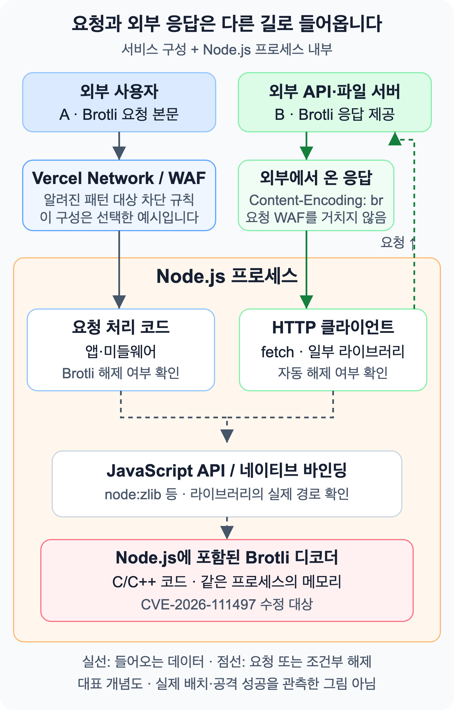
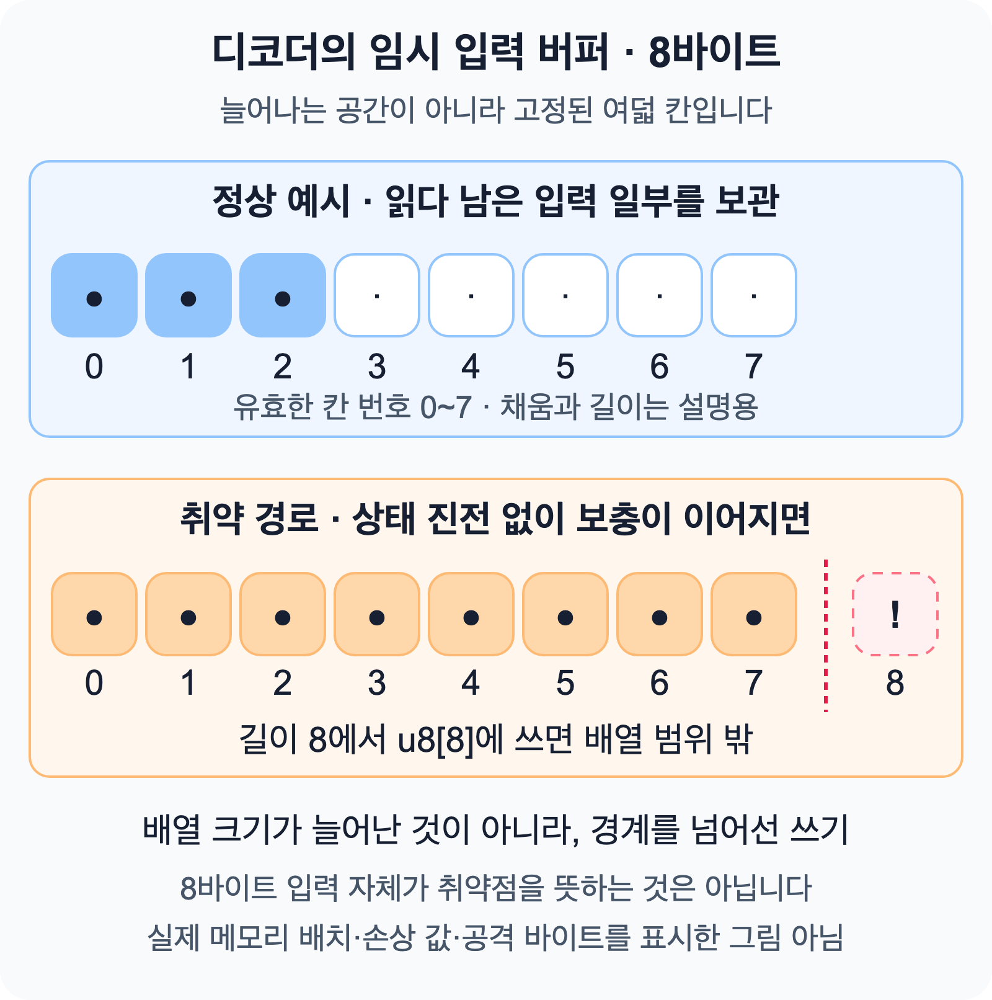
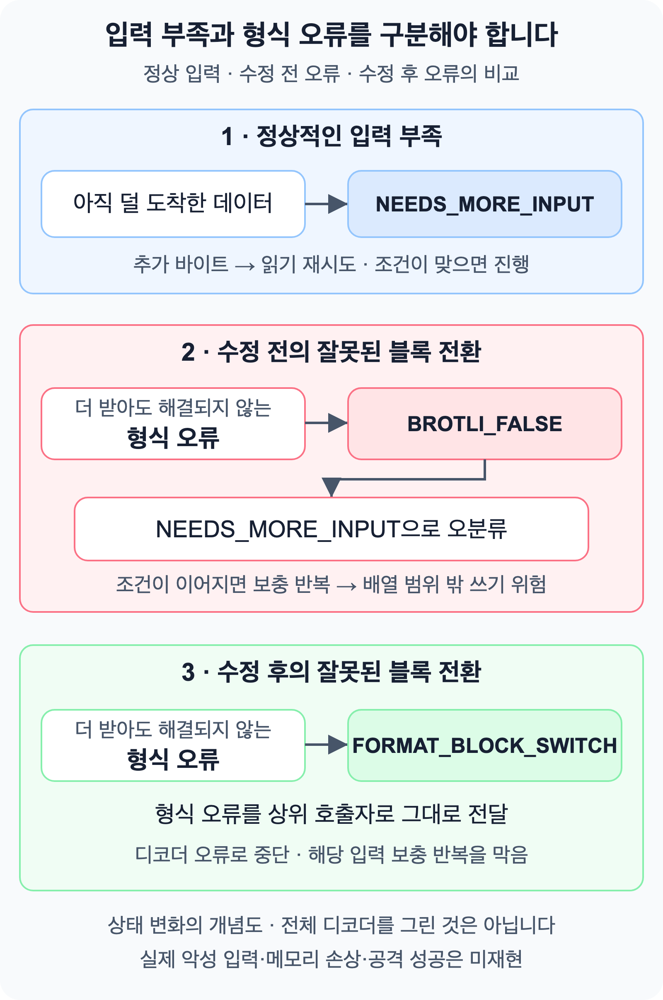
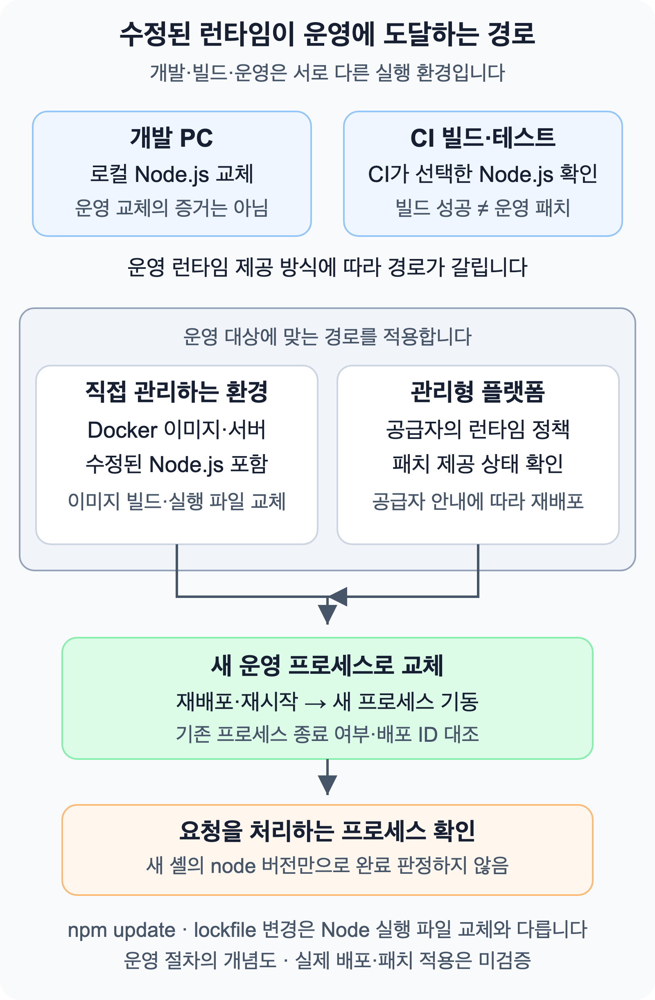

## 패키지 목록만 봐서는 알 수 없는 취약점

`package.json`의 의존성을 모두 업데이트해도 취약한 코드가 남을 수 있습니다. 이번에는 애플리케이션이 아니라 **Node.js 실행 파일에 포함된 Brotli 디코더**가 대상이기 때문입니다. 별도의 Brotli 패키지를 설치하지 않았더라도 앱이나 라이브러리가 이 디코더로 외부 데이터를 압축 해제할 수 있습니다.

2026년 10월 21일 [Node.js 보안 공지](https://nodejs.org/en/blog/vulnerability/october-2026-security-releases)는 Brotli 디코더의 범위 밖 쓰기 취약점 **CVE-2026-111497**을 높은 위험도로 발표했습니다. 공격자가 제어하는 Brotli 데이터를 애플리케이션이 압축 해제하는 것이 노출 조건입니다. 공식 공지는 가능한 영향으로 프로세스 종료, 프로세스 메모리 정보 노출, 원격 코드 실행을 제시합니다. 영향이 관측됐다는 의미는 아닙니다.

수정이 포함된 Node.js로 실행 환경을 갱신하고, 재배포 뒤 실제 요청을 처리하는 프로세스가 교체됐는지 확인해야 합니다. 이 글은 10월 28일에 확인한 공지와 수정 코드를 기준으로 데이터 경로와 오류가 생기는 과정을 살펴봅니다.

## 외부 데이터가 디코더에 닿는 경로

Brotli는 데이터를 작게 만드는 압축 방식입니다. 압축된 바이트를 원래 데이터로 복원하는 코드가 **디코더**(decoder)입니다. HTTP의 `Content-Encoding: br`에서 `br`은 Brotli를 뜻합니다.

외부 데이터를 받는 경로는 요청 본문만이 아닙니다. 애플리케이션이 외부 서버에 요청을 보내고, 그 응답을 HTTP 클라이언트 라이브러리가 자동으로 압축 해제하는 경로도 확인해야 합니다. 직접 `node:zlib`를 호출하지 않아도 사용 중인 라이브러리가 호출할 수 있습니다. 업로드 파일이나 메시지 큐의 데이터를 직접 디코더에 넣는 등, 다른 입력 경로도 같은 기준으로 확인합니다.

<figure style={{ maxWidth: '44rem', margin: '1.5rem auto' }}>



<figcaption>
    A는 외부에서 들어오는 요청, B는 앱이 가져온 외부 응답입니다. 실제 HeapForge
    배치나 공격 성공을 관측한 그림은 아닙니다.
</figcaption>

</figure>

그림의 큰 상자는 **실행 중인 Node.js 프로세스**입니다. 그 안에서 JavaScript로 작성한 앱·라이브러리가 C/C++로 구현된 네이티브 디코더를 호출할 수 있습니다. 네이티브는 여기서 Node.js 실행 파일에 포함된 코드를 뜻합니다. `npm update`만으로 이 디코더가 교체되지 않는 이유가 이 경계에 있습니다.

점선은 해제 동작이 있는 경우의 연결입니다. 모든 HTTP 요청이나 모든 라이브러리가 디코더를 호출하는 것은 아닙니다. 그림의 WAF는 Vercel을 경유하는 요청 구성의 예시이며, 관리형 런타임의 임시 보호 적용 여부는 아래에서 따로 살펴봅니다.

내 서비스의 경로를 찾을 때는 코드에서 `node:zlib`, `brotliDecompress`, `createBrotliDecompress`, `Content-Encoding` 처리를 먼저 찾아볼 수 있습니다. 다만 검색 결과가 없다는 사실만으로 해제 경로가 없다고 결론 내리기는 어렵습니다. 사용 중인 HTTP 클라이언트나 미들웨어가 내부에서 해제할 수 있으므로, 해당 버전의 문서와 설정에서 자동 압축 해제 여부도 확인해야 합니다. `node:http`를 사용한다는 사실만으로 자동 해제가 된다고 가정해서도 안 됩니다.

외부 응답을 추적할 때는 두 HTTP 헤더도 구분해야 합니다. 요청의 `Accept-Encoding: br`은 클라이언트가 Brotli 응답을 받을 수 있다고 알리는 값입니다. 응답의 `Content-Encoding: br`은 응답에 담긴 데이터(표현)에 Brotli 압축이 적용됐다는 표시입니다. 요청에서 `br`을 제안했다고 해서 응답이 반드시 Brotli로 오는 것은 아닙니다. 반대로 실제 응답에 `br`이 표시돼도, 그 헤더만으로 어느 디코더가 실행됐는지까지 알 수는 없습니다. 자동 해제하는 클라이언트라면 앱이 보는 헤더나 바이트가 처리 전과 다를 수 있으므로 해당 구현의 동작도 확인합니다.

요청 본문은 서버가 해제하도록 구성돼 있는지 살펴보고, 외부 응답은 앱이 어느 서버의 데이터를 가져오는지와 그 데이터를 누가 제어할 수 있는지를 함께 따져봅니다. [Vercel의 영향 경로 설명](https://vercel.com/kb/bulletin/node-js-security-advisory#who-is-affected)도 두 경로를 구분합니다.

## 잘못된 형식을 입력 부족으로 받아들인 과정

스트리밍 디코더는 데이터를 조금씩 받아 압축을 풉니다. 이때 **아직 덜 도착한 데이터**와 **형식부터 잘못된 데이터**를 구분해야 합니다. 전자는 다음 조각을 기다릴 수 있지만, 후자는 더 받아도 올바른 데이터가 되지 않으므로 오류로 멈춰야 합니다.

내부 원인을 스트리밍 디코더의 상태로 설명한다고 해서 JavaScript의 스트림 클래스만 영향 대상이라고 단정할 수는 없습니다. 실제로 어떤 API와 라이브러리가 외부 Brotli 데이터를 해제하는지, 그 API가 사용하는 런타임이 수정됐는지를 확인해야 합니다.

### 8바이트 임시 입력 버퍼

Brotli 디코더에는 읽다 남은 입력을 잠시 보관하는 **고정 크기 8바이트 공간**이 있습니다. 압축을 푼 전체 결과를 담는 공간이나 JavaScript의 `Buffer` 객체가 아닙니다. [공식 상태 구조체의 일부](https://github.com/google/brotli/blob/0ed4268a4401abcb4472096340477cf4af7d1a2b/c/dec/state.h#L264-L268)를 보면 크기를 확인할 수 있습니다.

```c source="state-storage"
union {
  uint64_t u64;
  uint8_t u8[8];
} buffer;
brotli_reg_t buffer_length;
```

`uint8_t`는 1바이트를 담는 C 타입입니다. `u8[8]`은 여덟 칸짜리 배열이며, 칸 번호인 인덱스는 **0부터 7까지**입니다. `union`은 같은 공간을 여러 타입으로 바라보는 C 문법이므로, 위 두 줄이 각각 8바이트씩 따로 차지하는 것은 아닙니다. `buffer_length`는 이 임시 공간에 보관한 바이트 수입니다.

이 공간이 필요한 이유는 입력이 스트림으로 나뉘어 도착할 수 있기 때문입니다. 디코더의 비트 리더는 바이트를 그대로 복사하는 대신, 압축 형식에서 필요한 비트들을 읽어 다음 동작을 해석합니다. 한 번의 읽기를 마치기 전에 입력이 끝나면 남은 조각을 이 공간에 보관합니다. Brotli의 [상태 구조체 주석](https://github.com/google/brotli/blob/0ed4268a4401abcb4472096340477cf4af7d1a2b/c/dec/state.h#L262-L268)은 디코딩을 진행하는 데 64비트면 충분하다는 형식의 전제를 설명합니다. 네트워크 청크 전체가 8바이트여야 한다는 뜻은 아닙니다.

<figure style={{ maxWidth: '44rem', margin: '1.5rem auto' }}>



<figcaption>
    칸 하나는 1바이트입니다. 색과 보관 길이는 설명용이며, 실제 메모리 주소나
    손상된 값을 측정한 그림은 아닙니다.
</figcaption>

</figure>

배열 크기는 그대로인데 그 밖의 위치에 쓰는 것을 **메모리 범위 밖 쓰기**(out-of-bounds write)라고 합니다. 입력이 8바이트라는 사실만으로 오류가 생기는 것은 아닙니다. 문제는 잘못된 형식에서 상태가 진행되지 않는데도 입력을 보충하는 경로를 계속 타게 된다는 점입니다.

정상적인 입력 부족과 이번 형식 오류가 수정 전후에 어떻게 처리되는지 나란히 보면 차이가 드러납니다.

<figure style={{ maxWidth: '44rem', margin: '1.5rem auto' }}>



<figcaption>
    공식 공지와 소스의 제어 흐름을 단순화한 그림입니다. 취약점이나 공격 성공을
    직접 재현한 결과는 아닙니다.
</figcaption>

</figure>

정상 흐름부터 살펴보겠습니다. 내부 버퍼가 비어 있으면 비트 리더는 들어온 입력을 직접 읽습니다. 읽기를 마치기 전에 데이터가 부족해지면 남은 입력을 임시 공간에 옮기고, 다음 입력이 오면 필요한 만큼 보충하면서 같은 읽기를 다시 시도합니다. 읽기가 끝나 임시 공간의 입력을 모두 소비하면 `buffer_length`를 0으로 되돌리고 원래 입력 스트림으로 돌아갑니다. 이 흐름은 [수정 전 스트리밍 루프](https://github.com/google/brotli/blob/34f020fa9daba975747b29885314c2545b7aa040/c/dec/decode.c#L2411-L2455)에서도 확인할 수 있습니다. `NEEDS_MORE_INPUT`은 이 디코더의 상태 값이지 HTTP 요청을 다시 보낸다는 뜻이 아닙니다.

반면 이번 오류는 더 많은 입력이 와도 해결할 수 없는 상황에서 발생합니다. 여기서 **블록 전환**(block switch)은 압축 데이터의 해석에 쓰는 블록 타입을 바꾸는 동작입니다. 허용되지 않은 전환은 입력 부족이 아니라 형식 오류입니다. [Node.js 공지](https://nodejs.org/en/blog/vulnerability/october-2026-security-releases)는 이를 입력 부족으로 잘못 보고해 내부 버퍼 경계를 넘을 수 있었다고 설명합니다.

### 코드에서 오류의 의미가 사라지는 지점

아래는 [수정 직전 Brotli 코드](https://github.com/google/brotli/blob/34f020fa9daba975747b29885314c2545b7aa040/c/dec/decode.c#L1189-L1191)의 짧은 발췌입니다. `max_block_type`은 해당 종류 데이터에 정의된 블록 타입 수입니다. 블록 전환을 처리하는 이 지점에서 타입이 하나 이하라 전환할 수 없으면 형식 오류입니다. 그런데 수정 전 함수는 입력이 부족할 때와 마찬가지로 `false`만 반환했습니다. 값 하나에 서로 다른 원인이 담긴 셈입니다.

```c source="before-invalid"
if (max_block_type <= 1) {
  return BROTLI_FALSE;
}
```

그런데 [safe 처리 경로의 매크로](https://github.com/google/brotli/blob/34f020fa9daba975747b29885314c2545b7aa040/c/dec/decode.c#L1943-L1954)는 호출 결과가 `false`이면 `NEEDS_MORE_INPUT`, 즉 ‘입력이 더 필요함’으로 바꿨습니다. `safe`는 사용자가 켜는 보안 기능이 아니라 디코더가 충분한 입력을 확인하며 읽는 내부 경로입니다. 아래는 매크로의 줄 연결 기호와 들여쓰기만 정리한 발췌입니다.

```c source="before-retry"
if (!Safe##METHOD) {
  result = BROTLI_DECODER_NEEDS_MORE_INPUT;
  goto saveStateAndReturn;
}
```

이 매크로는 호출이 실패하면 결과를 `NEEDS_MORE_INPUT`으로 정하고 상태를 저장하는 지점으로 이동합니다. 하지만 전달받은 `false`만으로는 실제 입력 부족과 형식 오류를 구별할 수 없습니다. 입력을 더 받아도 해결되지 않는 오류가 재시도 가능한 상태로 바뀌는 지점입니다.

정상적인 입력 부족일 때는 재시도가 필요합니다. 예를 들어 블록 길이를 읽을 비트가 모자라면 디코더는 읽기 전의 비트 리더 상태를 복원해 다음 입력으로 다시 시도합니다. 반면 타입이 하나 이하인 상태에서 블록을 전환하려는 경우에는 그 판단이 읽기 전에 끝납니다. 바이트를 더 붙여도 이미 잘못된 전환이 올바르게 바뀌지는 않습니다. 두 경우의 처리를 [같은 함수의 분기](https://github.com/google/brotli/blob/34f020fa9daba975747b29885314c2545b7aa040/c/dec/decode.c#L1189-L1206)에서 비교할 수 있습니다.

외부 스트리밍 루프에는 기존 버퍼로 읽기를 끝내지 못하고 새 입력이 있을 때 [한 바이트를 보충하는 코드](https://github.com/google/brotli/blob/34f020fa9daba975747b29885314c2545b7aa040/c/dec/decode.c#L2448-L2450)가 있습니다.

```c source="before-append"
BROTLI_DCHECK(s->buffer_length < 8);
s->buffer.u8[s->buffer_length] = **next_in;
s->buffer_length++;
```

`s->`는 현재 디코더 상태의 필드에 접근하는 C 표현입니다. 두 번째 줄은 다음 입력 한 바이트를 현재 보관 길이 위치에 쓰고, 세 번째 줄은 그 길이를 1 늘립니다. 형식 오류인데도 입력 보충이 반복되면 고정 배열의 범위를 벗어날 수 있습니다.

예를 들어 설명을 위해 보관 길이가 7이라고 가정해 보겠습니다. 아직 처리하지 못한 버퍼가 있고 새 입력도 남아 있다면, 위 코드는 인덱스 7에 한 바이트를 쓴 뒤 길이를 8로 바꿉니다. 이후 같은 형식 오류가 다시 입력 부족으로 바뀌고, 버퍼가 소진되지 않은 채 새 입력이 남아 있어 보충 분기에 또 도달한다면 다음 쓰기 위치는 인덱스 8입니다. 이때 디버그 단언이 활성화돼 있으면 단언 실패로 중단될 수 있습니다. 그렇지 않은 경로에서는 0~7만 허용되는 배열 밖을 쓰게 됩니다. 이 수치는 제어 흐름을 설명하는 가정이며, 여기서 실제 공격 입력을 만들거나 실행한 것은 아닙니다.

첫 줄에 검사처럼 보이는 코드가 있지만, [`BROTLI_DCHECK`는 디버그·로그 빌드 설정에 따라 동작하는 단언](https://github.com/google/brotli/blob/0ed4268a4401abcb4472096340477cf4af7d1a2b/c/common/platform.h#L468-L474)입니다. 모든 빌드에서 실행되는 입력 검증이라고 판단하면 안 됩니다. 이번 확인에서는 공식 Node.js 바이너리의 빌드 플래그까지 검증하지 않았습니다.

### 수정: 참·거짓 대신 상태를 전달

[공식 수정](https://github.com/google/brotli/commit/0ed4268a4401abcb4472096340477cf4af7d1a2b)은 형식 오류에 별도의 결과를 사용합니다. 아래 `-`는 이전 코드, `+`는 수정된 코드입니다.

```diff source="fixed-format"
 if (max_block_type <= 1) {
-    return BROTLI_FALSE;
+    return BROTLI_DECODER_ERROR_FORMAT_BLOCK_SWITCH;
 }
```

수정은 반환 값 하나만 바꾼 것이 아닙니다. 함수의 반환형을 `BROTLI_BOOL`에서 `BrotliDecoderErrorCode`로 바꿔 **성공·입력 부족·형식 오류를 구분하는 상태 코드**를 전달하고, 중간 호출자들도 그 결과를 보존하도록 바꿨습니다. [호출하는 매크로](https://github.com/google/brotli/blob/0ed4268a4401abcb4472096340477cf4af7d1a2b/c/dec/decode.c#L1968-L1982) 역시 그 상태를 그대로 상위로 전달합니다. 아래도 줄 연결 기호와 들여쓰기를 정리한 발췌입니다.

```c source="fixed-status"
if (status != BROTLI_DECODER_SUCCESS) {
  result = status;
  goto saveStateAndReturn;
}
```

이제 형식 오류가 ‘입력을 더 기다림’으로 바뀌지 않으므로 해당 입력 보충 경로를 계속 타지 않고 디코더가 오류로 멈출 수 있습니다. 상위 디코더의 [결과 변환 코드](https://github.com/google/brotli/blob/0ed4268a4401abcb4472096340477cf4af7d1a2b/c/dec/decode.c#L120-L140)는 성공과 입력 부족을 각각 구분하고, 형식 오류는 디코더 오류 결과로 돌려줍니다. 이것이 곧바로 특정한 JavaScript 예외 형태를 뜻하는지는 사용하는 Node.js 바인딩을 따로 확인해야 합니다.

핵심은 배열을 늘리는 것이 아니라 **오류의 의미를 호출 단계마다 보존하는 것**입니다. C에서 배열 밖 쓰기는 정의되지 않은 동작이므로, 어떤 인접 값이 바뀔지나 매번 어떤 결과가 발생할지를 이 코드만으로 단정할 수 없습니다.

이 절의 C 코드와 diff는 Google Brotli 저장소의 MIT 라이선스 소스에서 발췌했습니다. 매크로 일부는 읽기 쉽도록 줄 연결 기호와 들여쓰기를 정리했습니다. 원본 파일의 저작권 표기와 라이선스는 글 끝에 정리했습니다. 이 발췌는 독립 실행 예제나 공격 재현 결과는 아닙니다.

## 수정된 런타임을 운영에 반영하기

10월 21일 보안 릴리스에서 제시한 수정 버전은 다음과 같습니다. 아래는 각 계열의 **해당 수정이 포함된 버전**이며, 앞으로도 최신이라는 뜻은 아닙니다.

| Node.js 계열 | 수정이 포함된 보안 릴리스                              |
| ------------ | ------------------------------------------------------ |
| 22.x         | [22.23.4](https://nodejs.org/en/blog/release/v22.23.4) |
| 24.x         | [24.22.1](https://nodejs.org/en/blog/release/v24.22.1) |
| 26.x         | [26.12.1](https://nodejs.org/en/blog/release/v26.12.1) |

같은 계열의 이전 공식 바이너리를 사용 중이라면 이 수정이 포함된 지원 버전으로 업데이트해야 합니다. 배포판이나 공급자가 별도 패치를 제공한다면 해당 보안 공지와 빌드 정보를 확인합니다. 지원이 끝난 Node.js 20.x 같은 계열은 Node.js 공식 보안 수정 대상이 아니므로 지원되는 계열로 이전해야 합니다. 공급자의 별도 유지보수 빌드라면 그 공급자의 패치 내역을 따로 확인합니다.

`npm update`나 lockfile 변경은 일반적으로 Node.js 실행 파일을 교체하지 않습니다. 컨테이너와 CI에도 각각 사용하는 런타임이 있으므로, 개발 PC의 업데이트만으로 모든 환경이 바뀌었다고 판단하면 안 됩니다.

### 정상 입력 테스트가 알려 주는 범위

아래 예제는 직접 만든 짧은 문자열만 압축하고 복원합니다. 취약점 공격 입력은 사용하지 않습니다. 두 코드 블록을 순서대로 `brotli-runtime-check.mts` 한 파일에 저장합니다. 이 예제는 Node.js v24.22.1에서 실행했습니다.

#### 1/2 — 압축할 바이트 만들기

```ts filename="brotli-runtime-check.mts" part="1/2"
import assert from 'node:assert/strict'
import { brotliCompressSync, brotliDecompressSync } from 'node:zlib'

const original = Buffer.from(
    'Brotli is part of the Node.js runtime.\n'.repeat(16)
)
const compressed = brotliCompressSync(original)
```

#### 2/2 — 복원 결과와 실행 버전 출력

```ts filename="brotli-runtime-check.mts" part="2/2"
const restored = brotliDecompressSync(compressed)
assert.deepEqual(restored, original)

console.log(
    JSON.stringify(
        {
            node: process.versions.node,
            brotli: process.versions.brotli,
            inputBytes: original.length,
            compressedBytes: compressed.length,
            restored: restored.equals(original),
        },
        null,
        2
    )
)
```

`Buffer`는 바이트를 담는 객체입니다. `assert.deepEqual()`은 복원한 바이트가 원본과 같은지 검사하고, 다르면 실행을 실패시킵니다. `Sync` 함수는 완료할 때까지 같은 스레드의 JavaScript 실행을 기다리게 하므로, 이 짧은 확인용 예제를 큰 입력의 요청 처리 코드로 그대로 옮기지는 마세요.

```sh
node brotli-runtime-check.mts
```

10월 28일 macOS의 Node.js v24.22.1에서 얻은 출력은 다음과 같습니다.

```json
{
    "node": "24.22.1",
    "brotli": "1.2.0",
    "inputBytes": 624,
    "compressedBytes": 54,
    "restored": true
}
```

이 결과는 실행한 Node.js 버전과 정상 데이터의 복원 동작을 보여줍니다. **정상 압축 해제에 성공했다는 사실은 취약점 공격이 차단된다는 증거가 아닙니다.** 이 예제는 `node:zlib`와 현재 런타임만 확인합니다. 실제 요청·외부 응답이 어떤 라이브러리를 거쳐 해제되는지는 별도로 추적해야 합니다.

출력의 Brotli 버전은 `1.2.0`입니다. Node.js 24.22.1은 Brotli 버전 문자열을 새 버전으로 바꾸는 대신 관련 수정을 가져온 릴리스입니다. 따라서 `process.versions.brotli`의 숫자만으로 패치 여부를 판정하지 말고 [Node.js 릴리스의 수정 내역](https://nodejs.org/en/blog/release/v24.22.1)을 함께 확인해야 합니다. 다른 빌드에서는 출력이나 압축 크기가 달라질 수 있습니다.

### WAF와 런타임 패치의 역할

WAF는 웹 요청을 검사하고 차단하는 방화벽입니다. 앞단 WAF의 보호 범위와 애플리케이션이 외부에서 가져오는 응답 경로는 다릅니다.

**10월 26일 게시되고 10월 28일 확인한 Vercel 안내 기준**으로, WAF는 알려진 공격 패턴을 대상으로 한 차단 규칙을 제공합니다. 외부 서버에서 가져오는 응답은 그 보호 범위에 포함되지 않습니다. Vercel은 패치되지 않은 관리형 Node.js의 새 배포에 외부 서버로 보낸 요청의 Brotli 응답 처리를 막는 임시 보호도 안내하며, 기존 프로젝트에는 재배포를 요구합니다. WAF나 임시 보호를 런타임 업데이트의 대체 수단으로 취급하지 않아야 합니다.

직접 관리하는 서버와 컨테이너는 수정된 Node.js를 사용하도록 실행 환경을 갱신하고 프로세스·이미지를 교체해야 합니다. Vercel 관리형 런타임의 패치 정책을 외부 백엔드에도 적용됐다고 가정하지 않습니다. [공급자의 최신 대응 안내](https://vercel.com/kb/bulletin/node-js-security-advisory)를 현재 설정과 대조해 주세요.

### 설정과 실행 중인 프로세스의 차이

개발 PC와 CI, 운영 서버는 각자 다른 Node.js를 실행할 수 있습니다. CI는 코드를 빌드·검사하는 자동 실행 환경입니다. 아래에서 직접 관리하는 이미지·서버와 공급자가 관리하는 런타임은 **서로 다른 배포 경로**입니다. 한 서비스가 두 환경을 함께 운영할 수도 있습니다.

<figure style={{ maxWidth: '44rem', margin: '1.5rem auto' }}>



<figcaption>
    런타임 수정 → 배포·재시작 → 실제 프로세스 확인의 순서입니다. 운영 배포나
    패치 적용을 실제로 검증한 결과는 아닙니다.
</figcaption>

</figure>

| 확인 위치     | 확인할 내용                                          |
| ------------- | ---------------------------------------------------- |
| 개발 PC       | 명령을 실행하는 Node.js 버전                         |
| CI 작업       | 빌드·테스트 단계가 실제로 선택한 버전                |
| 컨테이너      | 새 이미지 안의 실행 버전과 교체 여부                 |
| 운영 프로세스 | 요청을 처리하는 프로세스의 버전과 재시작·재배포 결과 |

개발 셸과 실제 CI·컨테이너가 선택한 실행 파일을 확인할 때는 다음 명령을 사용할 수 있습니다.

```sh
node -p "process.versions.node"
```

이 명령은 **그 환경에서 새로 시작한 Node.js**의 버전을 출력합니다. 이미 요청을 처리 중인 서버는 시작 로그나 관리형 실행 환경의 기록에서 버전을 확인하고, 이미지 식별자·배포 버전·재시작 시점까지 함께 대조합니다. 버전 확인만을 위해 외부 공개 API를 만들 필요는 없습니다.

버전 설정 파일을 바꾼 사실과 이미 떠 있는 프로세스가 교체된 사실은 다릅니다. 이 글에서는 로컬 정상 입력 예제만 실행했으며, 운영 서버의 패치·재배포나 공격 차단을 검증하지 않았습니다.

## 마무리

먼저 외부에서 들어온 Brotli 데이터를 어느 코드나 라이브러리가 압축 해제하는지 찾습니다. 그 경로를 실행하는 Node.js에 수정이 반영되도록 환경을 갱신한 뒤, 실제 요청을 처리하는 프로세스까지 교체됐는지 확인합니다. 해제 경로는 코드와 라이브러리 설정으로 추적하고, 로컬 정상 입력 테스트는 선택한 런타임과 API의 정상 동작을 확인합니다. 어느 쪽도 실제 운영 프로세스에 패치가 반영됐다는 증거를 대신하지는 않습니다.

이 결함의 핵심은 `false`라는 값 자체보다, 호출 단계를 거치며 실패 원인이 사라졌다는 데 있습니다. 다음 입력을 기다릴 상태와 즉시 멈출 오류를 반환값에서 구분해야 호출자도 올바른 동작을 선택할 수 있습니다.

## 참고 자료와 더 읽을거리

취약점의 영향과 수정 내용을 확인하려면 먼저 다음 공식 자료를 읽어 보세요.

- [Node.js 2026년 10월 보안 공지](https://nodejs.org/en/blog/vulnerability/october-2026-security-releases): CVE-2026-111497의 영향과 수정된 Node.js 계열.
- [Node.js 24.22.1 릴리스 노트](https://nodejs.org/en/blog/release/v24.22.1): Node.js 24 계열에 Brotli 수정이 반영된 내역.
- [Brotli 수정 커밋](https://github.com/google/brotli/commit/0ed4268a4401abcb4472096340477cf4af7d1a2b): 블록 전환 오류의 반환값과 호출자 처리가 바뀐 실제 코드.
- [Vercel 보안 안내](https://vercel.com/kb/bulletin/node-js-security-advisory): WAF와 관리형 런타임의 대응 범위. 현재 적용 상태는 공급자의 최신 안내에서 다시 확인해야 합니다.

기초부터 이어서 공부한다면 아래 순서를 권합니다.

- [Node.js 스트림 문서](https://nodejs.org/api/stream.html): 데이터가 나뉘어 전달되는 스트림과 버퍼링의 기본 개념.
- [HTTP 의미론 RFC 9110](https://www.rfc-editor.org/rfc/rfc9110.txt): 8.4절의 `Content-Encoding`과 12.5.3절의 `Accept-Encoding`을 비교할 수 있습니다.
- [Node.js zlib 문서](https://nodejs.org/api/zlib.html#zlibcreatebrotlidecompressoptions): Brotli 압축 해제 API와 HTTP 응답 처리 예제. 사이트에서 표시하는 문서 버전이 실행 환경과 같은지 확인하세요.
- [Brotli 형식 명세 RFC 7932, 6절](https://www.rfc-editor.org/rfc/rfc7932.html#section-6): 블록 전환 명령의 구조를 자세히 읽고 싶을 때 참고할 수 있는 심화 자료입니다.

## 출처와 저작권

발췌한 `decode.c`의 원본 헤더에는 Copyright 2013 Google Inc., `state.h`의 원본 헤더에는 Copyright 2015 Google Inc.가 표시돼 있습니다. 프로젝트의 MIT 라이선스에는 Copyright (c) 2009, 2010, 2013–2016 by the Brotli Authors가 기재돼 있습니다. 저작권 고지와 허가 조건은 [MIT 라이선스 전문](/licenses/brotli-MIT.txt)에서 확인할 수 있으며, 각 코드 조각 옆의 링크에서 해당 커밋의 원문 파일을 볼 수 있습니다.

본문의 도식은 공개된 설명과 소스의 흐름을 바탕으로 직접 구성한 개념도입니다. 위에 링크한 문서와 그 안의 글·그림·코드에는 각각의 저작권과 이용 조건이 적용됩니다.
