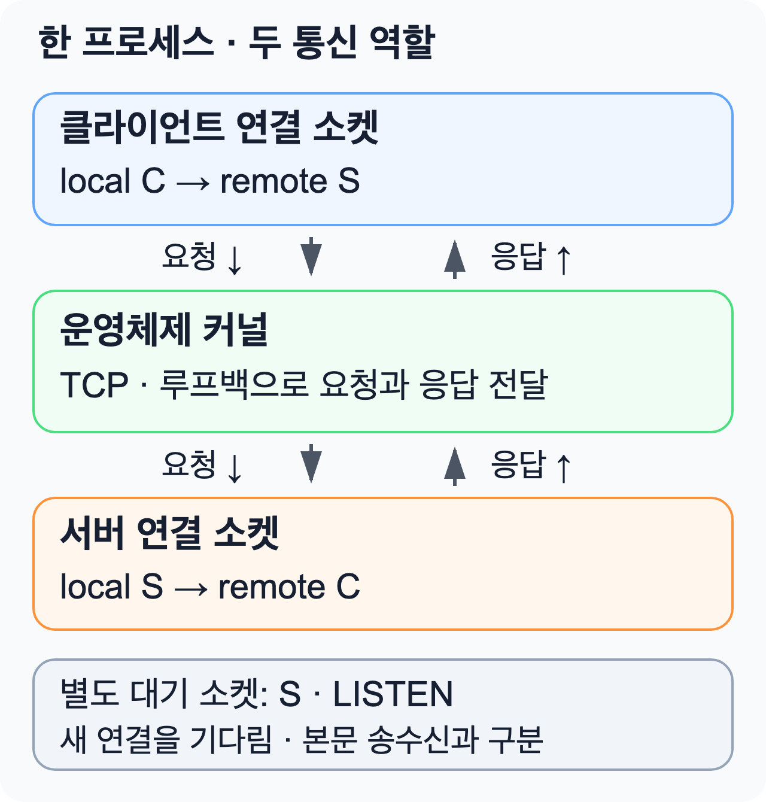
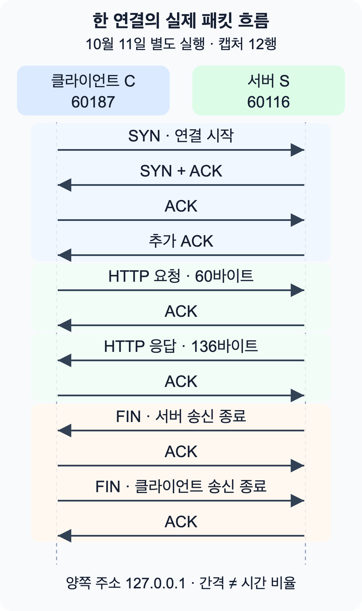

## HTTP 연결을 구성하는 두 끝점

`localhost:3000`에 접속하면 서버는 3000번 포트에서 기다립니다. 클라이언트에도 연결에 사용하는 포트가 있습니다. 서버에서 새 연결을 기다리는 소켓과 요청·응답을 주고받는 연결 소켓은 역할이 다릅니다.

[앞선 HTTP 응답 실험](/ko/docs/category/be/node-js/http-response-streaming-lab)에서 한 단계 더 내려가 보겠습니다. 이번에는 **Node.js에서 읽은 주소·포트와 운영체제의 소켓 목록을 대조**합니다. 실험은 macOS와 Node.js v24.12.0에서 실행했습니다. 이번에는 호스트 이름 `localhost` 대신 IPv4 루프백 주소인 `127.0.0.1`을 명시합니다.

## 주소·포트·소켓의 역할

| 용어               | 이번 실험에서의 의미                                                                                 |
| ------------------ | ---------------------------------------------------------------------------------------------------- |
| 주소               | 접속할 컴퓨터를 가리킵니다. `127.0.0.1`은 현재 컴퓨터로 돌아오는 루프백 주소입니다.                  |
| 포트               | 같은 주소에서 통신 끝점을 구분하는 번호입니다. 서버와 클라이언트 양쪽에 있습니다.                    |
| 소켓               | 프로그램이 네트워크 통신을 사용하는 끝점입니다. 여기서는 TCP 소켓을 사용합니다.                      |
| `local` / `remote` | 해당 소켓에서 본 **내 쪽 / 상대 쪽**입니다. 서버 연결 소켓에서는 클라이언트가 상대(remote) 쪽입니다. |
| LISTEN             | 서버 소켓이 새 연결을 기다리는 상태입니다.                                                           |
| ESTABLISHED        | TCP 연결이 성립한 상태입니다. HTTP 응답 완료를 뜻하지는 않습니다.                                    |

TCP는 두 끝점 사이에서 바이트를 순서대로 전달하는 통신 규칙입니다. 이 실험에서는 HTTP 요청과 응답을 TCP 연결 위에 실어 보냅니다.

서버 포트를 **S**, 클라이언트 포트를 **C**라고 부르겠습니다. C는 연결할 때 운영체제가 임시로 선택하는 포트입니다. 같은 연결을 양쪽에서 보면 순서가 뒤집힙니다.

<figure style={{ maxWidth: '28rem', margin: '1.5rem auto' }}>



</figure>

서버가 연결을 수락하면(`accept`) 대기 소켓은 계속 다음 연결을 기다리고, 서버는 해당 클라이언트와 통신할 별도 연결 소켓을 사용합니다. 둘은 같은 서버 포트 S를 사용합니다.

연결은 **내 주소·내 포트·상대 주소·상대 포트**, 네 값의 조합으로 구분합니다. 다음은 같은 서버에 두 클라이언트가 연결한 **가상 예시**이며, 이번 실험의 실제 측정값은 아닙니다.

| 서버에서 본 연결 | 내 주소:포트   | 상대 주소:포트  |
| ---------------- | -------------- | --------------- |
| 연결 A           | 127.0.0.1:3000 | 127.0.0.1:51001 |
| 연결 B           | 127.0.0.1:3000 | 127.0.0.1:51002 |

서버 포트가 같아도 상대 포트가 달라 두 연결을 구분할 수 있습니다. 실제로는 다른 컴퓨터의 상대 주소가 다를 수도 있습니다. ([TCP 연결의 정의](https://www.rfc-editor.org/rfc/rfc9293.html#section-2.2))

## 소켓 관측 결과

출력의 `listening`은 서버 대기 소켓의 주소, `client`는 클라이언트 쪽, `accepted`는 서버 연결 소켓 쪽에서 읽은 값입니다. `kernelSockets`는 `lsof`로 조회한 운영체제 소켓 목록입니다.

다음은 2026-10-16에 원문 코드를 재실행한 결과 하나를 **읽기 쉽게 재배열한 요약**입니다. 소켓 목록의 사용자명·내부 식별자 등은 생략했습니다.

```text
서버 대기: 127.0.0.1:62225
클라이언트: local 127.0.0.1:62226 → remote 127.0.0.1:62225
서버 연결: local 127.0.0.1:62225 → remote 127.0.0.1:62226

LISTEN       127.0.0.1:62225
ESTABLISHED  127.0.0.1:62226 → 127.0.0.1:62225
ESTABLISHED  127.0.0.1:62225 → 127.0.0.1:62226

HTTP 200 / complete: true / connections: 1
본문: "hello from TCP\n"
```

**한 TCP 연결인데 ESTABLISHED 행은 두 개**입니다. 이번에는 한 프로세스가 양쪽 역할을 맡으므로 그 프로세스의 클라이언트 소켓과 서버 연결 소켓이 모두 보입니다. LISTEN 행은 계속 새 연결을 기다리는 별도 소켓입니다.

**클라이언트 local = 서버 remote**, **클라이언트 remote = 서버 local**입니다. Node.js에서 읽은 값과 운영체제 소켓 상태가 서로 맞는지 확인할 수 있습니다.

Node.js의 소켓은 프로그램에서 사용하는 객체이고, `lsof`는 프로세스가 연 운영체제 소켓을 조회합니다. 이번 대조는 두 관측의 주소·포트가 맞는지 확인한 것입니다.

### HTTP 응답 완료와 TCP 연결 종료

`connections: 1`은 서버가 받아들인 TCP 연결 수입니다. HTTP 요청 수와 같은 뜻은 아닙니다. `complete: true`도 연결 종료 표시가 아닙니다.

| 관측한 값·이벤트        | 확인하는 범위                                   |
| ----------------------- | ----------------------------------------------- |
| 응답의 `complete: true` | HTTP 메시지 전체를 받아 정상적으로 파싱했습니다 |
| 응답 스트림의 `end`     | JavaScript에서 읽을 응답 데이터가 더 없습니다   |
| TCP의 FIN               | 해당 방향에서 더 보낼 데이터가 없음을 알립니다  |
| 소켓의 `close`          | Node.js에서 해당 소켓이 닫혔음을 알립니다       |

이번 예제는 HTTP/1.1이며 `Connection: close`로 응답 뒤 연결을 닫습니다. 그래서 응답 완료와 TCP 종료가 연이어 보입니다. **연결 재사용(keep-alive)을 사용하면 응답이 끝나도 같은 연결로 다음 요청을 보낼 수 있습니다.** 어느 신호도 사용자 화면 표시 완료를 뜻하지는 않습니다. ([HTTP 메시지 완료](https://nodejs.org/download/release/v24.12.0/docs/api/http.html#messagecomplete), [연결 재사용](https://nodejs.org/download/release/v24.12.0/docs/api/http.html#class-httpagent))

## 실제 패킷 관측 결과

2026년 10월 11일 14:12:37에 `tcpdump`로 한 연결을 관측했습니다. 이번 실행의 클라이언트 포트는 `60187`, 서버 포트는 `60116`입니다. 앞선 소켓 출력 예시와 다른 실행이므로 포트도 다릅니다.

**SYN**은 연결 시작 신호, **ACK**는 수신 확인, **FIN**은 해당 방향의 송신 종료 신호입니다. **패킷**은 네트워크에서 전달하는 데이터 묶음입니다. 그 안의 TCP 세그먼트에는 연결 신호·순서 번호·수신 확인 번호·데이터가 들어갑니다. 아래는 원본 12행을 단계별로 요약한 내용입니다.

<figure style={{ maxWidth: '28rem', margin: '1.5rem auto' }}>



<figcaption>
    시간은 위에서 아래로 흐릅니다. 10월 11일 별도 실행의 관측 요약이며, 화살표
    간격은 시간 비율이 아닙니다.
</figcaption>

</figure>

<details>
<summary>단계별 관측 기록 펼치기</summary>

| 단계 | 실제 관측                                             | 의미                                                            |
| ---- | ----------------------------------------------------- | --------------------------------------------------------------- |
| 연결 | 클라이언트 SYN → 서버 SYN+ACK → 클라이언트 ACK        | 양쪽 시작 순서 번호를 교환하고 확인합니다                       |
| 요청 | 클라이언트 → 서버, TCP 데이터 60바이트                | 뒤따른 ACK에서 서버 TCP가 요청 데이터 수신을 확인했습니다       |
| 응답 | 서버 → 클라이언트, TCP 데이터 136바이트               | 뒤따른 ACK에서 클라이언트 TCP가 응답 데이터 수신을 확인했습니다 |
| 종료 | 서버 FIN → 클라이언트 ACK → 클라이언트 FIN → 서버 ACK | 각 방향에서 더 보낼 데이터가 없음을 알리고 확인합니다           |

</details>

이 한 연결에서는 요청과 응답이 각각 데이터 세그먼트 하나에 실렸습니다. HTTP 응답에는 상태 줄·헤더·빈 줄이 포함되므로 **본문 `hello from TCP\n`의 15바이트와 TCP 데이터 136바이트는 다릅니다.** 다른 실행에서는 데이터가 여러 세그먼트로 나뉠 수도 있습니다. ACK는 여러 바이트의 수신을 한꺼번에 확인하거나, 늦게 보내거나, 반대 방향 데이터에 함께 실을 수도 있습니다. **데이터 하나마다 별도 ACK가 즉시 온다는 보장은 아닙니다.** ([TCP 수신 확인 규칙](https://www.rfc-editor.org/rfc/rfc9293.html#section-3.8.6.3))

<details>
<summary>seq와 ack 숫자 해석</summary>

`seq`는 이 방향으로 보내는 바이트의 순서 번호이고, `ack`는 상대 방향에서 **다음으로 기대하는 번호**입니다. 실제 요청의 범위는 `197459811:197459871`이었습니다. 끝 번호는 포함하지 않으므로 `197459871 - 197459811 = 60`바이트입니다. 뒤따른 서버의 `ack 197459871`도 이 범위와 맞습니다.

응답은 `1070684334:1070684470`이므로 136바이트이고, 클라이언트가 `ack 1070684470`으로 확인했습니다. SYN과 FIN은 데이터 길이가 0이어도 순서 번호 하나를 차지합니다. 서버 FIN 번호 `1070684470`을 확인하는 클라이언트 ACK는 그래서 `1070684471`입니다. 순수 ACK 자체는 번호를 차지하지 않습니다. ([TCP 순서 번호](https://www.rfc-editor.org/rfc/rfc9293.html#section-3.4))

</details>

캡처 종료 집계는 `12 packets captured`, `0 packets dropped by kernel`이었습니다. 뒤 숫자는 **캡처 과정에서 커널이 보고한 패킷 누락 수가 0**이라는 뜻이며, TCP 전송에 손실이 전혀 없었다는 증거는 아닙니다. `RST`는 캡처 행에서 관측되지 않았습니다. 양쪽 `FIN` 뒤에는 대응하는 `ACK`가 이어져 이 표본의 정상적인 종료 흐름을 확인했습니다. 연결 설정 뒤에는 데이터 없는 추가 ACK도 한 행 있었습니다. **3단계 핸드셰이크라고 해서 전체 캡처가 세 패킷이라는 뜻은 아닙니다.**

패킷 로그에는 본문 문자열이 없으므로, 본문과 HTTP 200·정상 완료 여부는 Node.js 수신 로그로 확인했습니다. TCP ACK도 JavaScript 처리나 화면 표시 완료를 뜻하지 않습니다.

## 관측 범위와 한계

주소·포트 대응, LISTEN 하나와 ESTABLISHED 두 개, HTTP 본문 보존을 원문 코드와 검증용 코드에서 각각 3회 확인했습니다. `lsof`는 응답 전 한 순간의 조회이고, 패킷 그림은 10월 11일의 별도 표본 한 연결입니다.

외부 인터넷·TLS·브라우저·CDN은 사용하지 않았습니다. 커널 내부 함수·버퍼 크기·TIME_WAIT 상태도 측정하지 않았습니다. 코드 안의 동기 `lsof` 조회가 응답을 늦추므로 이 실행 시간으로 네트워크 성능을 판단할 수 없습니다.

## 예제 실행

<details>
<summary>실행 코드 다섯 부분 펼치기</summary>

아래 1~5번 코드 블록 안의 내용만 위에서 아래 순서로 **`tcp-socket-endpoints.mts` 한 파일**에 붙여 넣어 주세요. Node.js v24.12.0에서는 이 예제의 타입 표기를 제거해 실행할 수 있습니다. 별도 변환 명령은 필요 없습니다. 이 실행은 타입을 검사하지는 않습니다. ([Node.js의 TypeScript 실행 범위](https://nodejs.org/download/release/v24.12.0/docs/api/typescript.html#type-stripping))

```sh
node --version
```

`lsof`는 프로그램이 연 파일과 소켓을 조회하는 도구입니다. macOS 기본 도구인 `/usr/sbin/lsof`가 필요하며 이 소켓 조회에는 관리자 권한을 사용하지 않습니다. 이 코드는 교육용입니다. `execFileSync()`가 도구를 실행하는 동안 JavaScript 실행이 멈추므로 운영 서버의 요청 처리 함수에 넣지 마세요.

### 1/5 — 연결된 소켓의 주소를 읽습니다

`Endpoint`는 한 소켓의 로컬·상대 주소와 포트를 묶은 TypeScript 타입입니다. `endpoint()`는 연결된 소켓에서 네 값을 읽습니다. `assert`는 조건이 틀리면 실행을 실패시키는 검사입니다. 연결 전에는 주소·포트가 준비되지 않을 수 있어 값부터 확인합니다.

```ts filename="tcp-socket-endpoints.mts" part="1/5"
import { createServer, get } from 'node:http'
import type { Socket, AddressInfo } from 'node:net'
import { once } from 'node:events'
import { execFileSync } from 'node:child_process'
import assert from 'node:assert/strict'

type Endpoint = {
    localAddress: string
    localPort: number
    remoteAddress: string
    remotePort: number
}
function endpoint(socket: Socket): Endpoint {
    assert.ok(socket.localAddress && socket.remoteAddress)
    assert.ok(socket.localPort && socket.remotePort)
    return {
        localAddress: socket.localAddress,
        localPort: socket.localPort,
        remoteAddress: socket.remoteAddress,
        remotePort: socket.remotePort,
    }
}
```

### 2/5 — 요청을 받은 동안 운영체제 목록을 읽습니다

`accepted`는 서버 연결 소켓에서 읽은 주소·포트입니다. 응답을 보내기 **전에** `lsof`로 양쪽 연결이 열린 순간을 관찰합니다. `-p`는 현재 프로세스만, `-i4TCP`는 IPv4 TCP 소켓만 고릅니다. `-a`는 두 조건을 함께 적용하고, `-nP`는 주소와 포트를 숫자로 표시합니다. 마지막 필터는 이번 서버 포트가 포함된 행만 남깁니다.

```ts filename="tcp-socket-endpoints.mts" part="2/5"
const body = 'hello from TCP\n'
let connections = 0
let accepted: Endpoint | undefined
let kernelSockets: string[] = []
const server = createServer((req, res) => {
    accepted = endpoint(req.socket)
    const lines = execFileSync(
        '/usr/sbin/lsof',
        ['-nP', '-a', '-p', String(process.pid), '-i4TCP'],
        { encoding: 'utf8', timeout: 3000 }
    )
        .trim()
        .split('\n')
    const ownPort = new RegExp(
        `127\\.0\\.0\\.1:${accepted.localPort}(?=->|\\s|$)`
    )
    kernelSockets = lines.filter((line) => ownPort.test(line))
    res.writeHead(200, {
        'Content-Type': 'text/plain',
        'Content-Length': Buffer.byteLength(body),
        Connection: 'close',
    })
    res.end(body)
})
```

### 3/5 — 서버 포트를 운영체제에 맡깁니다

포트 `0`은 사용 가능한 포트를 운영체제가 고르게 합니다. `listening` 이벤트를 기다린 뒤 실제 번호를 읽습니다. `connection` 이벤트가 발생할 때마다 `connections`를 1씩 늘려 서버가 수락한 연결 수를 셉니다. 선택형 `CAPTURE_TCP=1`에서는 클라이언트를 연결하기 전에 Enter를 기다립니다. 기본 실행에서는 기다리지 않습니다.

```ts filename="tcp-socket-endpoints.mts" part="3/5"
server.on('connection', () => {
    connections += 1
})
server.listen(0, '127.0.0.1')
await once(server, 'listening')
const listening = server.address() as AddressInfo
if (process.env.CAPTURE_TCP === '1') {
    console.error(
        `sudo /usr/sbin/tcpdump -i lo0 -nn -S -tttt -l 'tcp and host 127.0.0.1 and port ${listening.port}'`
    )
    console.error('캡처 준비 후 이 터미널에서 Enter를 눌러 주세요.')
    await once(process.stdin, 'data')
    process.stdin.pause()
}
```

### 4/5 — 클라이언트에서도 반대쪽을 읽습니다

`agent: false`로 이번 요청에 별도 연결을 사용합니다. `connect` 이벤트에서 주소·포트를 기록하고 응답 본문을 모읍니다. 클라이언트 소켓이 닫힌 뒤 대기 소켓도 닫습니다. 이 예제는 `Connection: close`를 지정했으며 연결 재사용은 다루지 않습니다.

```ts filename="tcp-socket-endpoints.mts" part="4/5"
let client: Endpoint | undefined
let received = ''
let complete = false
let statusCode: number | undefined
await new Promise<void>((resolve, reject) => {
    const request = get(
        {
            hostname: '127.0.0.1',
            port: listening.port,
            path: '/',
            agent: false,
        },
        (response) => {
            statusCode = response.statusCode
            response.setEncoding('utf8')
            response.on('data', (chunk) => {
                received += chunk
            })
            response.on('error', reject)
            response.on('end', () => {
                complete = response.complete
            })
        }
    )
    request.on('error', reject)
    request.once('socket', (socket) => {
        socket.once('close', () => {
            resolve()
        })
        socket.once('connect', () => {
            client = endpoint(socket)
        })
    })
})
await new Promise<void>((resolve, reject) => {
    server.close((error) => {
        if (error) reject(error)
        else resolve()
    })
})
```

### 5/5 — 양쪽 번호와 본문을 검사합니다

클라이언트의 `local`은 서버의 `remote`와 같아야 하고, 클라이언트의 `remote`는 서버의 `local`과 같아야 합니다. 주소 대응, 연결 하나, HTTP 200, 전체 본문, HTTP 메시지 완료도 함께 확인합니다.

```ts filename="tcp-socket-endpoints.mts" part="5/5"
assert.ok(client && accepted)
assert.equal(client.localPort, accepted.remotePort)
assert.equal(client.remotePort, accepted.localPort)
assert.equal(accepted.localPort, listening.port)
assert.equal(client.localAddress, accepted.remoteAddress)
assert.equal(client.remoteAddress, accepted.localAddress)
assert.equal(connections, 1)
assert.equal(received, body)
assert.equal(statusCode, 200)
assert.equal(complete, true)
console.log(
    JSON.stringify(
        {
            pid: process.pid,
            listening,
            client,
            accepted,
            connections,
            statusCode,
            received,
            complete,
            kernelSockets,
        },
        null,
        2
    )
)
```

다섯 부분을 저장한 뒤 실행합니다. 정상 실행이면 아래 조건을 검사한 JSON이 출력됩니다. 포트 번호는 매번 달라집니다.

```sh
node tcp-socket-endpoints.mts
```

</details>

## 선택 실습: 패킷 캡처

<details>
<summary>macOS의 두 터미널에서 캡처하기</summary>

앞의 다섯 코드 블록을 한 파일에 저장한 상태에서 진행합니다. 여기서는 macOS의 루프백 인터페이스 `lo0`만 관측합니다.

**터미널 A**에서 다음과 같이 실행합니다.

```sh
CAPTURE_TCP=1 node tcp-socket-endpoints.mts
```

프로그램은 대기 소켓만 연 뒤, 실제 서버 포트를 넣은 `sudo /usr/sbin/tcpdump ...` 명령을 출력합니다. **아직 Enter를 누르지 마세요.**

**터미널 B**에 A가 출력한 명령 전체를 그대로 복사합니다. 관리자 인증은 본인 터미널에서 진행합니다. `listening on lo0`가 보이면 A에서 Enter를 눌러 연결과 요청을 시작합니다. A의 JSON 출력이 끝난 뒤 B에서 Ctrl+C로 캡처를 종료합니다. B에서 권한 오류가 나거나 캡처를 취소했다면, A에서도 Enter 대신 Ctrl+C로 종료한 뒤 처음부터 다시 실행합니다.

B에서 SYN·요청·응답·종료 행과 종료 집계를 확인하고, 각 행의 포트가 A의 `client`·`accepted` 값과 맞는지 대조합니다. 다시 실행하면 포트가 바뀌므로 이전 명령을 재사용하지 마세요. 캡처가 준비되기 전에 Enter를 누르면 연결 시작 부분을 놓칠 수 있습니다.

패킷 수와 순서는 그림의 12행과 다를 수 있습니다. `listening on lo0`는 준비 완료일 뿐 수집 성공을 뜻하지 않으며, 실제 행과 종료 집계까지 확인해야 합니다. A의 일반 실행 결과만으로 캡처까지 성공했다고 판단하지 않습니다.

</details>

## 다음 글: CPU 작업과 수신 콜백

연결과 패킷을 확인한 다음에는 JavaScript의 수신 처리를 살펴보겠습니다. 10월 11일의 별도 TCP 실험에서 수신자에 CPU 작업이 없는 경우와 200ms 동안 계산하는 경우를 각각 3회 비교했습니다.

20ms로 예약한 타이머는 CPU 작업이 없을 때 약 20ms, 계산이 있을 때 약 200ms에 실행됐습니다. 수신 콜백도 계산이 끝난 뒤 실행됐고, 두 조건에서 받은 데이터는 모두 16,384바이트로 내용이 같았습니다. 여기서 측정한 것은 콜백 실행 시각이며 패킷 도착 시각은 아닙니다.

다음 글에서는 송신자와 수신자를 별도 프로세스로 나눈 코드와 시간 흐름도를 통해, CPU 작업이 타이머와 수신 처리를 늦추는 과정을 다룹니다.

참고: [Node.js Socket 주소·포트 API](https://nodejs.org/download/release/v24.12.0/docs/api/net.html#socketlocalport), [Node.js HTTP API](https://nodejs.org/download/release/v24.12.0/docs/api/http.html#messagecomplete), [TCP 연결 설정](https://www.rfc-editor.org/rfc/rfc9293.html#section-3.5).
