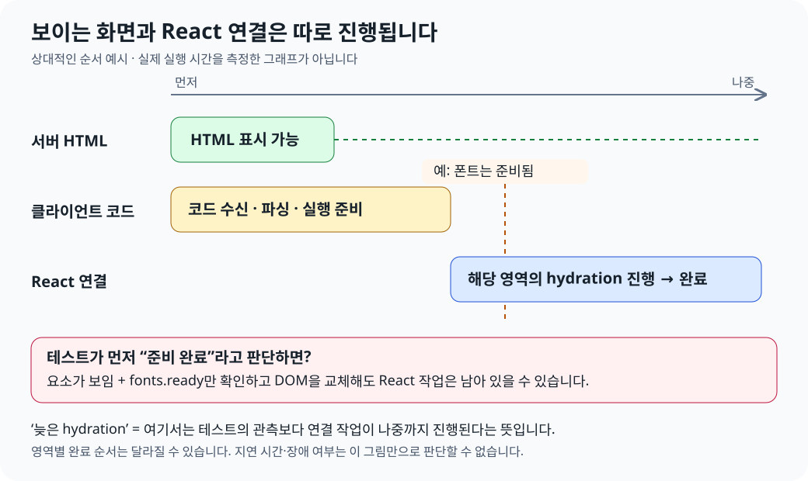
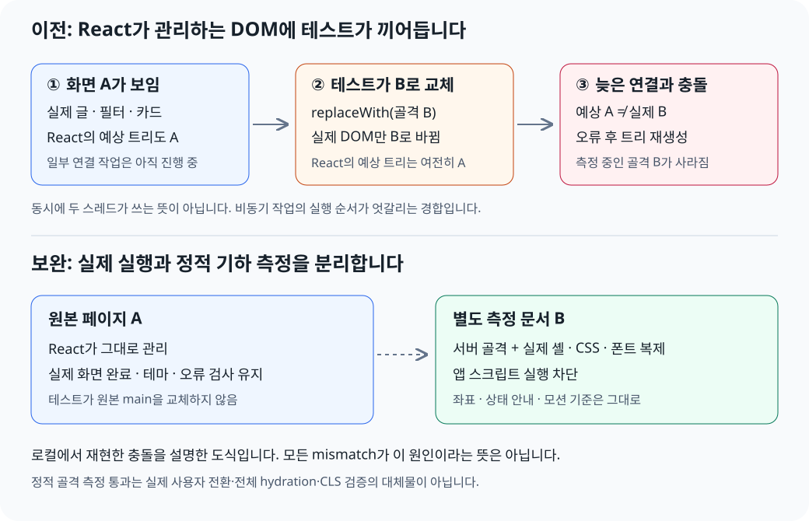

# 화면은 보이는데 hydration은 왜 아직 진행 중일까?

## 개념

최종 검토: 2026-10-27. 대상은 Next 16.4.3·React 19.2.6을 사용하는 docs 앱의 최초 접속과 스켈레톤 기하 검사다. 공개 블로그 게시물이 아니라 프로젝트 지식 문서이며, 새 성능 측정이나 배포 결과가 아니다.

**HTML을 화면에 그리는 일과 React가 그 화면에 연결되는 일은 다르다.** 서버는 제목·카드 등이 포함된 HTML을 먼저 보낼 수 있다. 브라우저는 그 HTML을 표시하면서 별도로 클라이언트 코드를 준비한다. React는 서버 HTML에 대응하는 컴포넌트 트리를 확인하고 필요한 상태·이벤트 처리를 연결한다. 이 연결 과정이 hydration이다.

Next의 Server Component 전체를 브라우저에서 다시 실행한다는 뜻은 아니다. 브라우저에서는 RSC payload를 사용해 서버/클라이언트 트리를 조합하고 Client Component 영역을 hydrate한다. Next의 설치된 문서도 HTML 미리보기, RSC payload, JavaScript hydration을 서로 구분한다.



그림은 상대적인 순서를 보여주는 예시다. 실제 밀리초·관측된 단일 실행의 시간표가 아니며, 코드/데이터 준비 상황에 따라 여러 작업은 겹치고 영역별 완료 순서도 달라진다.

## 왜 늦게 연결될 수 있는가

여기서 **‘늦다’는 테스트가 준비 완료라고 판단한 시점보다 나중까지 React 작업이 남았다는 뜻**이다. 지연 시간이 비정상적으로 길거나 사용자 서비스가 장애라는 의미부터 부여하지 않는다.

| 요인                      | 연결이 나중까지 진행될 수 있는 이유                                                                                       | 이번 조사에서의 확인 범위                                                                                 |
| ------------------------- | ------------------------------------------------------------------------------------------------------------------------- | --------------------------------------------------------------------------------------------------------- |
| 클라이언트 코드 준비      | HTML은 이미 표시돼도 필요한 코드의 수신·파싱·실행이 남을 수 있다. 개발 서버의 cold compile도 준비 시간을 늘릴 수 있다.    | 일반 원리다. 특정 파일의 전송/컴파일 시간을 이번 원인의 정량값으로 측정하지 않았다.                       |
| 메인 스레드의 다른 작업   | 코드가 도착해도 브라우저가 파싱·실행·이벤트 처리 등의 작업을 수행해야 한다. `load` 이후 예약된 React 작업도 남을 수 있다. | CPU 6배 지연을 사용한 교차 실행에서 충돌을 재현했다. CPU 지연만으로 개별 경로 20회에서는 재현되지 않았다. |
| Streaming과 Suspense 경계 | HTML·데이터·클라이언트 코드의 준비가 영역별로 다르다. React는 연결할 수 있는 영역과 상호작용 우선순위에 따라 작업한다.    | 프로젝트에 streaming/Suspense가 있다. 당시 CI의 경계별 hydration 시작·종료 시각은 측정하지 않았다.        |
| 개발 중의 추가 갱신       | Fast Refresh 같은 갱신이 트리를 다시 조정할 수 있다. 이는 최초 hydration 지연과 구분해야 한다.                            | 일부 로컬 실패에 rebuilding/done 로그가 동반했다. 모든 실패를 Fast Refresh 탓으로 확정하지 않았다.        |

HTML이 먼저 보이는 구조 자체는 SSR의 장점이다. 문제는 그 사이에 React가 관리할 DOM을 다른 코드가 예상과 다르게 바꾸는 데 있다. 단순히 번들을 줄이거나 hydration을 빨리 끝내도 이 테스트의 DOM 소유권 문제를 해결한 것은 아니다.

## 프로젝트에서 배운 점

### 기존 테스트가 오해한 준비 상태

기존 검사는 실제 화면에서 다음 조건을 확인한 뒤 서버 응답의 골격을 `main` 자리에 직접 넣었다.

```text
page.goto() 완료
→ 기존 로딩 골격 없음
→ 실제 카드/제목 보임
→ 테마 적용 확인
→ document.fonts.ready 완료
→ 원본 main을 스켈레톤으로 replaceWith()
```

각 조건은 필요하지만 **이후 React가 그 DOM을 변경하지 않는다는 보장은 아니다.** 특히 `document.fonts.ready`는 폰트/레이아웃 관련 준비를 기다리는 API이지 React의 작업 완료 API가 아니다.

### 실제로 충돌한 내용



1. 실제 화면 A가 표시된다. 그러나 해당 영역의 연결이나 트리 처리는 남아 있을 수 있다.
2. 테스트가 DOM만 골격 B로 교체한다. React에 대응하는 트리 변경을 요청한 것은 아니므로 React가 기대하는 화면은 여전히 A다.
3. 나중에 React가 그 영역을 확인하면서 A와 B의 불일치를 만난다.
4. 로컬 재현에서는 hydration 오류와 트리 재생성, 테스트가 주입한 골격의 제거가 관측됐다. 이를 모든 mismatch가 전체 앱을 지운다는 동작으로 일반화하지 않는다.
5. 다음 assertion이 골격 또는 상태 안내를 찾다가 실패한다. 빨리 측정하면 통과할 수도 있어 실행 순서에 민감하다.

다음은 로컬 오류의 특징을 줄여서 표현한 **설명용 비교**다. 전체 원본 로그를 그대로 옮긴 것이 아니다.

```diff
 React가 기대한 실제 화면
 <main>
+  <div>실제 허브 콘텐츠</div>

 테스트가 넣어둔 DOM
-<main aria-busy="true" data-page-pending="mobile">
-  <span role="status">문서를 불러오고 있어요.</span>
```

정제 artifact의 `hydrationReferencesInjectedPending: true`와 `pending: 0`, `main: true`가 관련 증거다. 수치·명령·실패 이력은 [검증 보고서](../../verification/resilience/2026-10-27-skeleton-runtime-isolation.md)와 [artifact](../../verification/artifacts/2026-10-27-skeleton-runtime-isolation.json)에 보존한다. 여기서 말하는 경합은 두 JavaScript 스레드가 같은 DOM에 동시에 쓰는 현상이 아니라, 비동기 작업의 실행 순서가 엇갈리는 문제다.

## 적용 조건과 주의점

### 준비 신호가 보장하는 범위

| 관측                           | 알 수 있는 것                                          | 보장하지 않는 것                          |
| ------------------------------ | ------------------------------------------------------ | ----------------------------------------- |
| 요소가 보임                    | 해당 DOM이 화면에 표시됨                               | 해당 영역/전체 앱의 hydration 완료        |
| `page.goto()` 기본 `load` 완료 | 브라우저의 load 이벤트 도달                            | 이후 예약된 React 작업이나 갱신의 종료    |
| `document.fonts.ready`         | 문서에서 진행 중인 폰트 로딩/관련 레이아웃 작업의 준비 | React 상태·이벤트 연결 완료               |
| `networkidle`                  | 일정 기간 네트워크 연결이 조용함                       | 실행 대기 중인 JavaScript/React 작업 없음 |
| 특정 컴포넌트의 Effect 실행    | 해당 컴포넌트가 commit돼 Effect가 실행됨               | 다른 Suspense 경계·전체 앱·향후 갱신 완료 |
| 버튼/Link 조작 후 기대 결과    | 그 상호작용 경로가 동작함                              | 나머지 모든 경계의 hydration 완료         |

UI 테스트에서는 실제 동작과 결과를 확인한다. 단순히 `enabled`인 버튼이나 네이티브 `details`가 동작한다는 사실만으로 전체 React 연결이 끝났다고 판단하지 않는다. 프레임워크 전체에 통용되는 ‘이후 DOM이 절대 변하지 않는 hydration 완료 시점’을 임의의 전역 플래그로 만들지 않는다.

### 이번 보완이 기다림을 늘리지 않은 이유

실제 페이지는 계속 React가 관리하게 두고, 기하 측정만 별도 정적 문서로 분리한다. 실제 서버 골격·셸·로드된 CSSOM·수신한 폰트 응답을 재사용하고 측정 문서에서 앱 스크립트가 실행되지 않게 한다. 따라서 원본의 늦은 연결/갱신이 측정 문서의 골격을 지울 수 없다.

`waitForTimeout()`·timeout/좌표 허용오차 증가·`suppressHydrationWarning`으로 통과시키거나, 실제 이동 검사에서 JavaScript를 꺼버리는 해결은 하지 않았다. Next가 관리하는 root를 임의로 unmount하는 방법도 사용하지 않았다. 기존 좌표·모션·접근성 기준과 원본의 완료/오류 검사는 유지한다.

### 확정한 사실과 남은 한계

- **확인:** 로컬의 기존 DOM 교체 방식에서 React 오류에 테스트 전용 골격 속성이 나타났고 해당 골격이 제거됐다. 따라서 테스트가 연결/트리 재생성과 충돌하는 사례를 재현했다.
- **미확정:** 원격 CI 두 건의 첫 attempt에서 정확히 어떤 호출자가 DOM을 바꿨는지는 trace가 없어 확정하지 못했다. HMR이 모든 실패의 원인이라는 결론도 내리지 않았다.
- **다른 문제:** 중간 보완의 CSS·폰트 재요청 대기는 별도 리소스 수신 문제다. 이를 hydration 지연의 직접 증거로 섞지 않는다.
- **검증 범위:** 정적 골격 기하 검사는 실제 사용자 전환·전체 hydration·운영 CLS 검사의 대체물이 아니다. 이번 설명 작업에서는 제품 코드 변경이나 새 브라우저 재검사를 하지 않았다.

## 관련 정책과 원문

- [로딩 정책](../../architecture/docs-loading-ux-policy.md) · [검증 보고서](../../verification/resilience/2026-10-27-skeleton-runtime-isolation.md) · [작업 기록](../../worklog/2026-10/2026-10-27-skeleton-runtime-isolation.md).
- 설치된 Next 문서: `apps/docs/node_modules/next/dist/docs/01-app/01-getting-started/05-server-and-client-components.md`, `01-app/03-api-reference/03-file-conventions/loading.md`. 최초 화면의 HTML/RSC/JavaScript 역할과 Selective Hydration을 확인했다.
- [React hydrateRoot](https://react.dev/reference/react-dom/client/hydrateRoot): 기존 HTML과 클라이언트 트리의 일치·DOM 관리 책임. `root.render`를 hydration 전에 부르면 root가 client rendering으로 전환된다는 주의는 참고 원리이며, 이번에 그 API를 직접 호출했다고 주장하는 근거는 아니다.
- [React Suspense](https://react.dev/reference/react/Suspense): streaming/selective hydration의 통합. 웹 문서의 현재 버전에만 있는 실험 기능은 이번 설명이나 구현에 적용하지 않았다.
- [CSS Font Loading의 ready](https://www.w3.org/TR/css-font-loading/#fontfaceset-ready) (W3C Working Draft): 폰트 로딩·관련 레이아웃의 준비 신호이며 React의 완료 신호가 아니다.
- [Playwright page.goto](https://playwright.dev/docs/api/class-page#page-goto): 기본 대기 이벤트는 `load`다. `networkidle`도 상호작용 준비를 증명하는 기준으로 사용하지 않는다.
