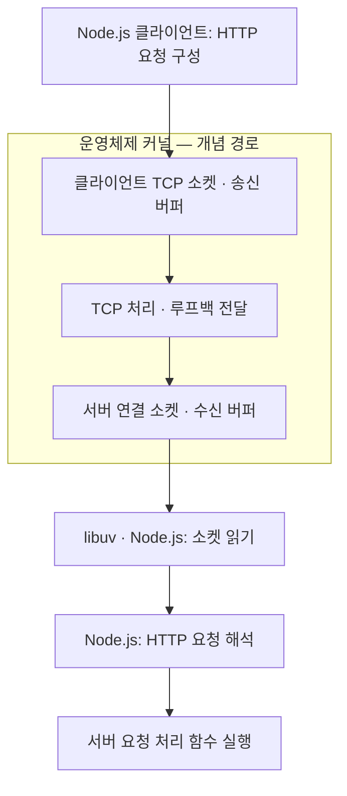
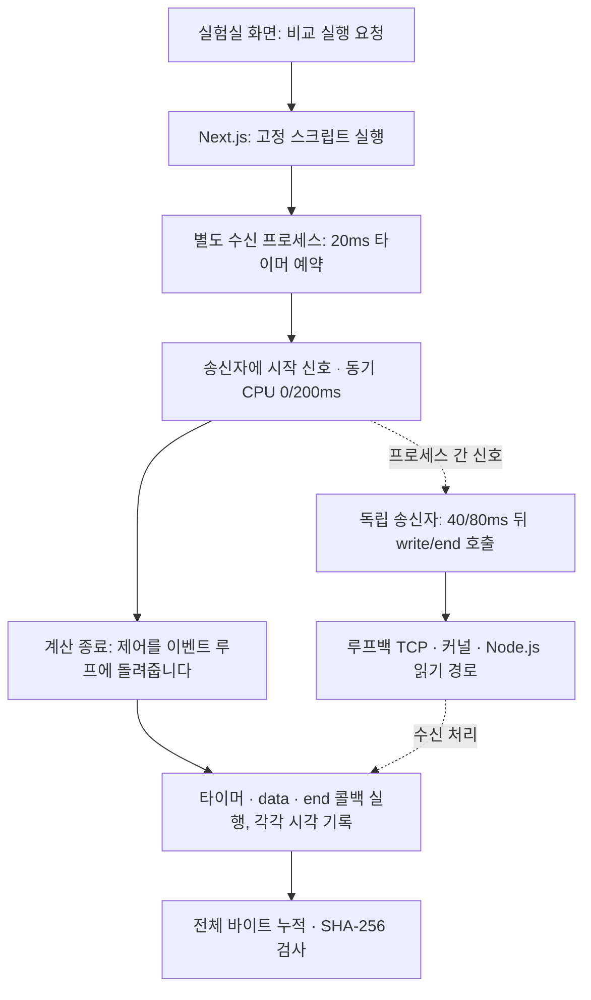
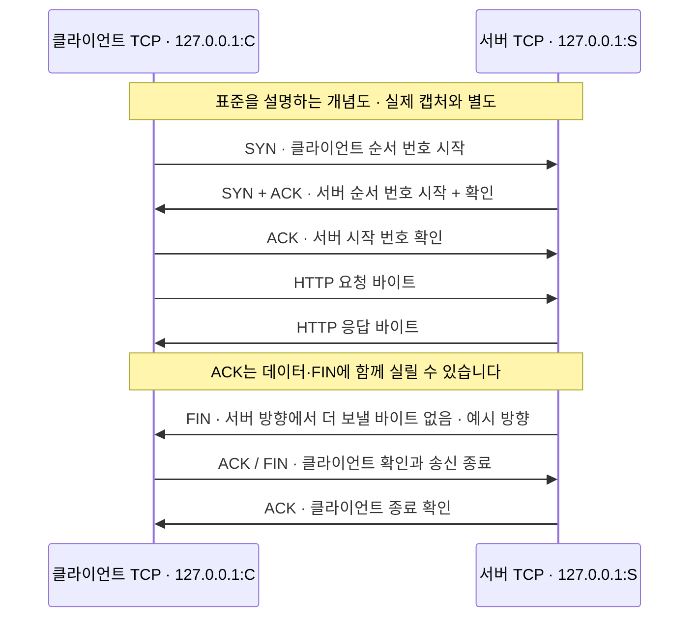

# Node.js HTTP 요청은 운영체제 안에서 어떻게 이동하나요?

## 개념

- 대상: Node.js HTTP/1.1 서버와 클라이언트의 로컬 TCP 통신
- 최종 검토: 2026-10-11
- 상태: 로컬 소켓·2026-10-11 한 연결의 TCP 패킷·동기 CPU 0/200ms 콜백 비교 관측 완료. 커널 내부 함수·버퍼 크기 계측은 미완료입니다.

이 문서는 [HTTP 스트리밍 초안](../../../apps/docs/category/be/node-js/http-response-streaming-lab.mdx)의
서비스 구조 그림에서 생긴 질문을 한 단계 더 설명합니다. 클라이언트와 서버가 같은
Node.js 프로세스 안에 있어도 TCP 소켓으로 통신하면 운영체제를 거칩니다.

**커널**은 운영체제에서 메모리·네트워크 등의 자원을 관리하는 핵심 부분입니다.
**버퍼**는 데이터를 다음 단계가 처리할 때까지 잠시 보관하는 메모리입니다.
**TCP**는 양쪽 프로그램 사이에서 순서가 있는 바이트 흐름을 전달하는 통신 규약입니다.
**libuv**는 Node.js가 운영체제별 비동기 입출력 기능을 사용하도록 돕는 라이브러리입니다.



화살표는 데이터의 개념 경로입니다. 커널의 정확한 함수 호출·메모리 복사 횟수나
매 단계의 완료 시각을 나타내지 않습니다. 응답 데이터는 반대 방향으로 이동합니다.

### 1. 서버가 연결을 기다립니다

`server.listen(0, '127.0.0.1')`은 현재 컴퓨터의 사용 가능한 포트에서 연결을
기다리게 합니다. 포트는 같은 주소에 있는 통신 끝점을 구분하는 번호입니다.
포트 `0`은 운영체제가 사용 가능한 번호를 선택하도록 요청하는 값입니다.

서버에는 연결 요청을 기다리는 **대기 소켓**이 있습니다. 연결이 수락되면
해당 클라이언트와 데이터를 교환하는 **연결 소켓**을 사용합니다.
대기 소켓 하나가 모든 클라이언트의 본문을 직접 읽는 구조는 아닙니다.

### 2. 클라이언트가 TCP 연결을 만듭니다

현재 예제의 `get()`은 `agent: false`로 요청합니다. 새 TCP 연결에서 양쪽은
보통 `SYN → SYN-ACK → ACK`(연결 요청 → 응답 → 최종 확인)로 연결을 확인합니다.
이를 **3-way handshake(3단계 연결 설정)**라고 합니다.
클라이언트 쪽에도 포트가 할당되어 양쪽 통신 끝점을 구분합니다.

루프백 통신에도 TCP 연결 절차가 있습니다. 기존 연결을 재사용하는 HTTP 요청마다
새 핸드셰이크가 필요한 것은 아닙니다. ([TCP 연결 표준](https://www.rfc-editor.org/rfc/rfc9293.html#section-3.5))

### 3. 요청 바이트를 전송하도록 넘깁니다

Node.js는 요청 메서드·경로·헤더를 HTTP 형식의 바이트로 구성합니다.
운영체제에 쓰기를 요청하는 경계를 **시스템 호출**이라고 합니다.
실제 구현에서는 여러 쓰기를 모아서 전달할 수 있으므로 JavaScript의 쓰기 호출과
시스템 호출이 항상 일대일로 대응하지는 않습니다.

커널의 송신 버퍼는 전송을 관리하는 데이터 보관 공간입니다. Node.js 안에도
별도의 쓰기 대기 공간이 있을 수 있습니다. **Node.js 버퍼와 커널 버퍼는 서로 다릅니다.**
([Node.js 소켓 설명](https://github.com/nodejs/node/blob/v24.12.0/doc/api/net.md))

### 4. TCP가 루프백 경로로 전달합니다

TCP는 순서가 있는 바이트 흐름을 제공합니다. 순서 번호·수신 확인·재전송·
수신 측이 받아들일 수 있는 데이터 양의 조절 등을 관리합니다. `127.0.0.1`로 보낸 데이터는
현재 컴퓨터 내부의 루프백 경로를 사용하며 외부 공유기나 인터넷으로 나가지 않습니다.
([TCP 표준](https://www.rfc-editor.org/rfc/rfc9293.html),
[루프백 주소 정의](https://www.rfc-editor.org/rfc/rfc1122.html#section-3.2.1.3))

TCP의 **ACK**는 TCP 계층에서의 수신 확인입니다. 서버의 JavaScript 함수가
요청을 처리했거나 사용자가 화면을 봤다는 확인은 아닙니다.
루프백의 세부 전달 구현과 최적화는 운영체제마다 다를 수 있습니다.

### 5. 서버가 읽을 때까지 수신 버퍼에 보관합니다

이 절의 타이머·수신 콜백 비교는 2026-10-11에 로컬 환경에서 조건별 3회 실행했습니다. 커널 내부의 패킷 도착 시각은 이번 실험의 측정 대상이 아닙니다.

서버 연결 소켓에 도착한 데이터는 커널의 수신 버퍼에서 프로그램의 읽기를
기다릴 수 있습니다. libuv는 운영체제의 준비 상태 확인 기능을 사용합니다.
macOS의 `kqueue`, Linux의 `epoll`은 여러 소켓 중 읽거나 쓸 준비가 된 소켓을
효율적으로 확인하는 기능입니다. 서버 하나에 연결이 많아도 연결마다
JavaScript 스레드를 하나씩 만드는 방식은 아닙니다.

준비 상태가 확인되면 이벤트 루프가 관련 입출력 처리를 진행합니다.
커널이 JavaScript 함수를 직접 호출하는 것은 아닙니다. JavaScript가 긴 계산으로
이벤트 루프를 붙잡고 있으면, 데이터가 도착해도 애플리케이션 처리는 늦어질 수 있습니다.
네트워크 소켓 입출력과 libuv의 파일 입출력용 스레드 풀은 서로 다른 기능입니다.
([libuv 설계 설명](https://docs.libuv.org/en/v1.x/design.html#the-i-o-loop))

#### 이벤트 루프는 무엇을 기다리나요?

**콜백**은 작업의 결과나 이벤트가 생겼을 때 실행하는 함수입니다. `setTimeout()`에
넘기는 함수와 소켓의 `data` 처리 함수가 그 예입니다. **이벤트 루프**는 입출력 준비 상태를
확인하고 타이머·입출력 등의 콜백 실행을 이어 가는 처리 흐름입니다. 모든 종류의 콜백이
하나의 대기열에 들어가는 것은 아닙니다.

동기 JavaScript 계산이 실행 중이면 같은 스레드에서 다른 JavaScript 콜백을 실행할 수
없습니다. 계산이 끝나 이벤트 루프에 제어를 돌려준 뒤 다음 처리를 진행합니다. 계산하는 동안 다른
프로세스나 운영체제 전체까지 멈추는 것은 아닙니다.
([Node.js 이벤트 루프 설명](https://nodejs.org/en/learn/asynchronous-work/event-loop-timers-and-nexttick))



화살표는 실행·데이터의 역할 관계입니다. 타이머와 `data` 콜백이 항상 같은 순서로 실행됨이나
커널 도착 시각을 나타내지 않습니다. 송신자를 별도 프로세스로 만들어 수신자의 계산이
송신 타이머까지 붙잡는 혼동을 줄였습니다. 이번 단계는 HTTP 파서 앞의 TCP 수신을
분리해 살펴봅니다.

#### 실제로 얼마나 늦어졌나요?


그림은 각 조건의 **첫 표본**이며 전체 3+3회 결과는
[실제 검증 보고서](../../verification/content/2026-10-11-node-event-loop-cpu.md)에 있습니다.
20ms 타이머가 200ms 계산 이후 실행됐고, 수신 콜백은 CPU 구간에 실행되지 않고 계산 종료 뒤 실행됐습니다.
본문은 양쪽 조건 모두 16,384바이트이며 최종 해시가 같았습니다.
콜백이 늦어졌다는 사실과 데이터가 사라졌다는 사실은 다릅니다.

`setTimeout(callback, 20)`은 정확히 20ms에 실행한다는 예약이 아닙니다. 실행할 수 있는
시점까지 기다립니다. 이번 기본 조건도 19.63~20.83ms로 관측됐으므로 반올림·시계·
스케줄링을 고려해 한 숫자에 맞춰 판정하지 않았습니다.

CPU 200ms 조건에서 두 번의 쓰기가 data 콜백 한 번으로 읽혔습니다. **쓰기 횟수와
읽기 조각 수는 같아야 하지 않습니다.** TCP가 메시지별 경계를 보존하지 않는 바이트
흐름이기 때문입니다. 읽은 조각을 모두 합쳐 순서·길이를 최종 해시와 대조합니다.
같은 결과가 모든 실행에서 항상 한 콜백으로 나온다고 일반화하지 않습니다.

#### 지연 값은 무엇을 뜻하나요?

`performance.now()`는 프로세스의 시간 원점 이후 경과 시간을 ms로 제공합니다.
실험에서는 시작 시 값을 빼서 그 표본의 타이머·수신 시각을 구했습니다. 송신자는
자기 시작 신호 수신부터 재므로 양쪽 숫자를 직접 빼서 네트워크 지연을 계산할 수 없습니다.

`monitorEventLoopDelay()`는 내부 타이머의 실행 간격으로 루프 지연을 표본으로 모읍니다.
여러 값의 분포를 담는 기록을 **히스토그램**이라고 합니다. 이번에는 약 200ms의 긴
루프 지연도 관측했습니다. 이 값은 CPU 사용률이나 네트워크 왕복 시간(RTT)이 아닙니다.
([Node.js v24.12.0 측정 API](https://nodejs.org/download/release/v24.12.0/docs/api/perf_hooks.html#perf_hooksmonitoreventloopdelayoptions))

측정기의 예열·단위 변환·초기 실패와 보강 과정은 검증 보고서에서 확인합니다.
이 검사에서 관측한 것은 **콜백 실행 시각**이며, 패킷이 CPU 중 도착했는지나 커널 큐에
얼마나 쌓였는지는 확인하지 않았습니다.

### 6. Node.js가 HTTP 요청을 해석합니다

Node.js가 읽은 바이트에서 메서드·경로·헤더를 해석하면 서버의 요청 처리 함수가
실행됩니다. 요청 본문 전체가 먼저 도착해야 하는 것은 아닙니다. 본문은 이후에도
`req`의 읽기 스트림으로 들어올 수 있습니다. 커널의 TCP 처리와 Node.js의 HTTP
해석은 서로 다른 책임입니다.
([Node.js HTTP 설명](https://nodejs.org/download/release/v24.12.0/docs/api/http.html#event-request))

## 이번 프로젝트에서 배운 점

2026-10-10 새 소켓 실험에서 한 프로세스의 클라이언트·서버 끝점을 읽고,
macOS `lsof`로 같은 프로세스의 운영체제 소켓 목록을 대조했습니다.
서버 대기 포트와 연결 포트가 같고 양쪽 local/remote가 뒤집히며,
LISTEN 하나와 ESTABLISHED 두 개가 나타났습니다. fixture와 실제 MDX 코드는
각각 3회 실행했습니다. 전체 본문·HTTP 완료도 검사했습니다.

이것은 **운영체제가 노출하는 소켓 상태 관측**입니다. 커널 함수의 실행 시각이나
버퍼 크기를 직접 추적한 것은 아닙니다. `tcpdump`는 BPF 권한 거부,
`sudo -n`은 관리자 인증 필요로 실패했습니다. SYN·ACK·패킷 시각은 미관측입니다.
캡처용 연결 대기 도구의 smoke 통과도 실제 패킷 수집과 구분합니다.

2026-10-11 사용자가 관리자 권한으로 재실행한 소켓 로그에서도 HTTP와 끝점 대응은
정상입니다. 다만 검토한 캡처 파일은 시작 메시지만 있었고, 한 재실행에서는
실행 중 tcpdump의 필터가 이전 서버 포트를 가리키는 것을 확인했습니다.
이후 캡처 준비와 연결 시작을 조율해 동일 끝점의 SYN·ACK·양방향 데이터·FIN과
마지막 ACK까지 확인했습니다. 캡처는 12개, 커널 drop 보고는 0개입니다.
상세 행·순서 번호 계산·종료 집계는
[10-11 실제 캡처 보고서](../../verification/content/2026-10-11-node-tcp-packet-capture.md)에 유지합니다.

- [소켓 학습 초안](../../../apps/docs/category/be/node-js/tcp-socket-endpoints-lab.mdx)
- [관측 조건·반복 검사·권한 한계](../../verification/content/2026-10-10-node-socket-kernel-observation.md)
- [재실행과 선택적 패킷 캡처 절차](../../runbooks/node-tcp-local-observation.md)

### 관측 위치별로 알 수 있는 범위

| 관측 위치                | 확인할 수 있는 것                                  | 이 관측만으로 확인할 수 없는 것 |
| ------------------------ | -------------------------------------------------- | ------------------------------- |
| `res.write()` 반환값     | 추가 데이터를 계속 써도 되는지 나타내는 신호       | 클라이언트의 본문 소비 완료     |
| 서버 응답의 `finish`     | 마지막 응답 데이터까지 운영체제에 전송하도록 넘김  | 클라이언트 수신·화면 표시 완료  |
| 클라이언트의 `data`      | 본문 일부가 JavaScript 수신 코드에 전달됨          | 모든 본문의 수신 완료           |
| 클라이언트의 `end`       | 응답 읽기 스트림의 정상 끝                         | 브라우저 렌더링 완료            |
| 이번 `lsof` 조회         | 해당 프로세스의 TCP 끝점과 LISTEN·ESTABLISHED 상태 | 패킷·ACK 시각·커널 버퍼 크기    |
| 2026-10-11 TCP 패킷 관측 | 연결·TCP 데이터·ACK·FIN 등의 통신 증거             | 서버 업무 처리·사용자 화면 확인 |

`finish`의 범위는 [Node.js 공식 정의](https://nodejs.org/download/release/v24.12.0/docs/api/http.html#event-finish_2)를 따릅니다.
기존 HTTP 실험은 애플리케이션 이벤트를 관측합니다. 커널 버퍼의 정확한 크기,
실제 시스템 호출은 아직 측정하지 않았습니다. 10월 11일 패킷 시각은 캡처 로그에서
확인했으며 JavaScript 콜백 시각과 정밀하게 대조하지 않았습니다.

## 적용 조건과 주의점

### 패킷 로그를 읽는 순서

처음에는 **방향 → Flags → seq/ack/length → 종료 집계** 순서로 읽으시면 됩니다.
윈도우 스케일이나 32비트 순환 같은 세부 사항은 첫 흐름을 이해한 뒤 확인하셔도 됩니다.

**소켓**은 프로그램이 통신에 사용하는 끝점입니다. **TCP 세그먼트**는 TCP가
순서 번호·제어 신호·데이터를 묶어 전달하는 단위이고, IP 패킷 안에 담깁니다.
`tcpdump`는 인터페이스의 패킷 관측 기록을 보여줍니다. `lsof`의 소켓 목록과
관측 위치가 다르므로, ESTABLISHED 상태를 읽었다는 사실만으로 SYN을 캡처했다고
말할 수는 없습니다.

같은 컴퓨터 안에서도 두 끝점은 구분됩니다. 아래의 C는 클라이언트가 배정받은
임시 포트, S는 서버가 기다리는 포트입니다. 재실행하면 둘 다 바뀔 수 있습니다.



위 그림은 개념 흐름이며 실제 패킷 수와 세부 순서는 캡처마다 달라질 수 있습니다.
10월 11일 표본에서는 연결·양방향 데이터·FIN과 ACK를 확인했습니다.

#### `Flags`, `seq`, `ack`, `length`는 무엇인가요?

| 로그 표기         | 의미                                                      | 주의점                                                             |
| ----------------- | --------------------------------------------------------- | ------------------------------------------------------------------ |
| `[S]`             | SYN: 연결을 시작하며 순서 번호를 알립니다                 | HTTP 요청 본문이 아닙니다                                          |
| `[S.]`            | SYN과 ACK가 함께 설정됐습니다                             | `.`는 ACK 플래그입니다                                             |
| `[.]`             | ACK 플래그가 설정됐습니다                                 | 데이터 길이까지 보고 순수 ACK인지 확인합니다                       |
| `[P.]`            | PSH와 ACK가 설정됐습니다                                  | `P` 하나로 JavaScript 콜백 실행·즉시 화면 표시를 보장하지 않습니다 |
| `[F.]`            | FIN과 ACK가 설정됐습니다                                  | 이 방향으로 더 보낼 바이트가 없다는 신호입니다                     |
| `[R]` 또는 `[R.]` | 연결 재설정 RST입니다                                     | 정상 종료인 FIN과 구분합니다                                       |
| `seq a:b`         | 이 방향의 TCP 데이터 순서 번호 범위입니다                 | 시작 a를 포함하고 끝 b는 제외합니다                                |
| `ack n`           | 상대 방향에서 다음으로 기대하는 순서 번호입니다           | JavaScript 업무 처리 성공 확인이 아닙니다                          |
| `length n`        | 해당 세그먼트에 실린 TCP 데이터 바이트 수입니다           | IP·TCP 헤더를 포함한 전체 패킷 크기가 아닙니다                     |
| `win n`           | 상대가 받아들일 수 있다고 광고하는 수신 윈도우 필드입니다 | 스케일 옵션을 함께 봐야 하며 Node.js의 highWaterMark와 다릅니다    |

현재 tcpdump 캡처 명령의 `-S`는 순서 번호를 **절대값**으로 출력합니다. 큰 숫자가 오류라는 뜻은
아닙니다. TCP의 각 방향은 별도의 시작 번호를 사용합니다.

다음 숫자는 이해를 위한 **가상 예시**이며 실제 캡처 결과가 아닙니다.

```text
C → S  SYN       seq 1000
S → C  SYN+ACK   seq 5000       ack 1001
C → S  ACK                     ack 5001
C → S  데이터    seq 1001:1061  length 60
S → C  ACK                     ack 1061
```

SYN은 데이터 길이가 0이어도 순서 번호 하나를 차지하므로 `1000 + 1 = 1001`입니다.
60바이트를 보낸 뒤 `ack 1061`이면 상대 TCP는 그 앞까지의 연속된 바이트를 확인하고
다음 번호 1061을 기대한다는 뜻입니다. FIN도 번호 하나를 차지하지만 순수 ACK는
차지하지 않습니다. 실제 번호의 비교는 32비트 순환을 고려합니다.
([TCP 순서 번호와 수신 확인](https://www.rfc-editor.org/rfc/rfc9293.html#section-3.4))

#### HTTP 본문 길이와 TCP 데이터 길이는 왜 다른가요?

실험의 `hello from TCP\n`는 UTF-8에서 15바이트입니다. TCP가 보내는 HTTP 응답에는
상태 줄과 헤더, 헤더·본문 경계를 나타내는 빈 줄도 있으므로 TCP 데이터 길이가
15보다 클 수 있습니다. 반대로 응답이 여러 세그먼트로 나뉘면 각 행의 길이는
일부분입니다. TCP는 애플리케이션의 쓰기 호출이나 HTTP 본문 경계를 보존하지 않습니다.

또한 캡처 명령은 `-A`·`-X`로 원문 바이트를 출력하지 않습니다. 따라서 캡처의 방향과
길이만으로 본문 문자열을 읽었다고 말하지 않습니다. 본문 값과 HTTP 완료는 소켓
실행 로그에서, 연결 신호·순서 번호·확인 번호는 패킷 로그에서 각각 확인합니다.

#### `listening on lo0`가 보이면 캡처 성공인가요?

이 문장은 캡처 도구가 인터페이스를 열고 기다린다는 뜻입니다. 필터에 맞는 패킷을
수집했다는 증거는 아닙니다. 아래 세 가지를 별도로 대조합니다.

1. 같은 실행의 소켓 JSON 포트와 캡처 필터 포트가 일치하는지 확인합니다.
2. 해당 끝점 사이의 패킷 행에서 SYN·ACK·데이터·종료를 읽습니다.
3. Ctrl+C 종료 집계에서 수집 수와 커널이 캡처 과정에서 버린(drop) 패킷 수를 확인합니다.

`packets captured`와 `packets received by filter`의 뜻은 OS와 수집 경로에 따라
달라질 수 있습니다. 두 수가 반드시 같아야 한다고 검사하지 않습니다.
`dropped by kernel: 0`도 캡처 시작 이전·종료 이후를 포함한 모든 통신을 봤다는
보장은 아닙니다. 해당 캡처 구간에서 도구가 보고한 캡처 중 커널의 폐기 수가 0이라는 뜻으로 읽습니다.

`lo0`와 `link-type NULL (BSD loopback)`는 이번 관측이 루프백 인터페이스임을
설명합니다. 외부 네트워크 카드·공유기·TLS·Vercel 운영 경로를 측정한 결과가 아닙니다.
`snapshot length`는 패킷마다 보관할 수 있는 최대 캡처 길이이며 TCP 수신 버퍼 크기나
실제 HTTP 본문 길이가 아닙니다.

로그 저장에는 `-l`로 패킷 텍스트의 줄 단위 출력을 켜고 `2>&1`로 종료 집계도
같은 파일에 넣습니다. `tee -i`는 Ctrl+C 때 먼저 종료하지 않고 tcpdump의 마지막
출력을 받을 수 있게 합니다. 자세한 명령은 [재현 절차](../../runbooks/node-tcp-local-observation.md)에 유지합니다.

플래그 표기와 캡처 옵션의 근거는 로컬 설치 버전의 `man tcpdump`
(tcpdump 4.99.1, Apple 158)입니다. TCP의 연결과 종료 개념은
[RFC 9293 연결 설정](https://www.rfc-editor.org/rfc/rfc9293.html#section-3.5)과
[연결 종료](https://www.rfc-editor.org/rfc/rfc9293.html#section-3.6)를 따릅니다.

### 적용 범위를 넓힐 때 주의할 점

- `highWaterMark`는 Node.js 스트림의 버퍼링 기준입니다. 운영체제 소켓 버퍼 크기나
  TCP의 수신 윈도우와 같은 값이 아닙니다. `highWaterMark`는 추가 쓰기를 잠시 멈출 기준이며 메모리 사용량의 절대 상한은 아닙니다.
  ([Node.js 스트림 버퍼링](https://nodejs.org/download/release/v24.12.0/docs/api/stream.html#buffering))
- `write()` 두 번과 `data` 두 번은 일대일 관계가 보장되지 않습니다. TCP는 쓰기
  조각의 경계를 보존하지 않습니다. ([TCP 바이트 흐름 정의](https://www.rfc-editor.org/rfc/rfc9293.html#section-2.2),
  [TCP 분할과 쓰기 경계](https://www.rfc-editor.org/rfc/rfc9293.html#section-3.7))
- HTTP 응답의 끝과 TCP 연결의 끝도 구분합니다. 연결 재사용(keep-alive)을 사용하면
  응답 이후에도 같은 연결을 다음 요청에 사용할 수 있습니다.
- 현재 실험은 HTTP/1.1·평문·TCP·루프백입니다. HTTPS에는 암호화 계층인 TLS가
  추가됩니다. HTTP/3은 TCP 대신 UDP 위의 통신 규약인 QUIC를 사용하므로
  이 경로를 그대로 적용할 수 없습니다. ([HTTP/3 표준](https://www.rfc-editor.org/rfc/rfc9114.html#section-2))
- Node.js 쪽 취소 이벤트만으로 TCP의 정상적인 송신 종료 신호인 FIN과 연결을
  재설정하는 RST 중 무엇이 발생했는지 단정하지 않습니다.
- Next.js의 서버 출력 뒤에는 프록시·압축·캐시·브라우저 처리가 추가될 수 있습니다.
  이 교육용 경로를 HeapForge 운영 인프라의 실측 결과로 취급하지 않습니다.

## 관련 정책과 절차

- [깊이를 쌓는 학습 로드맵](../../todo/todo.md#nodejs에서-운영-인프라까지-학습-로드맵): 다음 실험과 완료 조건의 원본입니다.
- [HTTP 스트리밍 초안](../../../apps/docs/category/be/node-js/http-response-streaming-lab.mdx): 실행 코드와 기존 관측 로그의 원본입니다.
- [기고 검증과 개발 서버 미리보기](../../runbooks/docs-article-rendering-regression.md): 테스트 연결·화면 검사·사용자 검토 절차입니다.
- [이번 문서 정리 기록](../../worklog/2026-10/2026-10-09-http-kernel-learning-roadmap.md)

- [문서·로드맵 재검사 기록](../../worklog/2026-10/2026-10-10-http-learning-roadmap-review.md)
