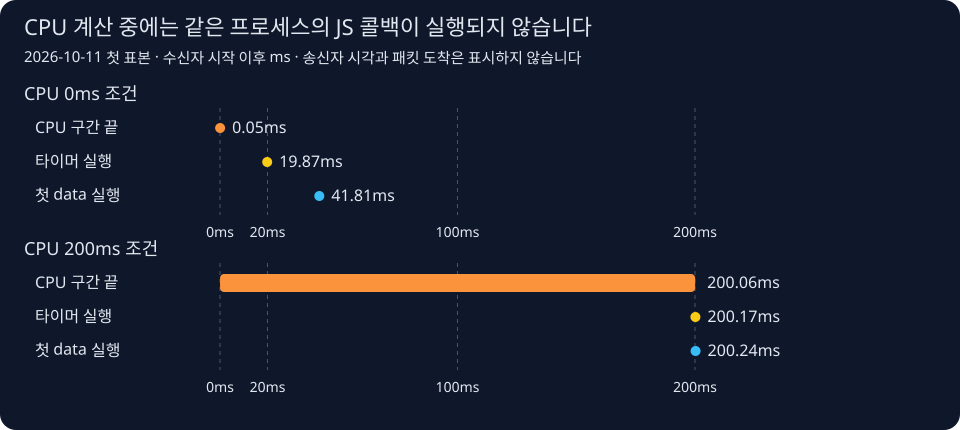

# Node.js 동기 CPU 작업과 타이머·TCP 수신 콜백 비교

## 대상과 조건

- 관측 완료: 2026-10-11 23:11:30 Asia/Seoul (`2026-10-11T14:11:30.854Z`).
- 기준: web-tech `d8c0952`의 미커밋 작업 트리와 별도 로컬 실험실. 배포 검증이 아닙니다.
- 도구: macOS, Node.js v24.12.0, TypeScript 6.0.3 .mts. 관리자 권한·패킷 캡처 없이 실행했습니다.
- 표본: CPU 0ms / 200ms 각 3회. 실행 순서는 0→200, 200→0, 0→200입니다.
- 송신자와 수신자는 별도 프로세스이며 IPv4 루프백 TCP로 연결합니다.
- 송신자는 시작 신호를 받은 뒤 40/80ms 타이머에서 각각 8,192바이트씩 `write()`와 `end()`를 호출합니다.
- 수신자는 CPU 작업 직전 20ms 타이머를 예약합니다. CPU 200ms 조건은 `performance.now()`를 확인하는 동기 반복문입니다. 측정한 벽시계 점유 시간이며 CPU 사용률은 아닙니다.

## 재현 방법

[실행 절차](../../runbooks/node-event-loop-cpu-observation.md)를 따릅니다.
로컬 실험실에서 `pnpm test:event-loop`를 실행했고 `EVENT_LOOP_ARTIFACT`로 결과 JSON을 저장했습니다.
`pnpm typecheck`로 타입을 검사했습니다. 실행·화면 스크립트는 아래 작업 기록에 연결합니다.

## 결과와 증거

기대 조건은 CPU 종료 이후 타이머·모든 data·end 콜백 실행, 최종 16,384바이트와
고정 SHA-256 일치, 활성화된 지연 측정기의 긴 지연 관측입니다. 6회 모두 통과했습니다.
0ms 조건의 CPU 구간 <50ms와 타이머 <100ms를 비교의 넓은 사전 허용 범위로 검사했습니다.
오염된 기본 표본은 성공으로 취급하지 않습니다. 정확한 20ms 일치는 요구하지 않습니다.
시간은 각 **수신자 원점 이후 ms**입니다. CPU 구간만 종료 시각에서 시작 시각을 뺀 시간입니다.

| CPU 조건(ms) | 회차 | CPU 구간(ms) | 타이머 실행 | 첫 data 실행 | end 실행 | 최대 루프 지연(ms) | data 횟수 |
| ------------ | ---- | ------------ | ----------- | ------------ | -------- | ------------------ | --------- |
| 0            | 1    | 0.00         | 19.87       | 41.81        | 81.38    | 1.49               | 2         |
| 0            | 2    | 0.00         | 19.63       | 41.04        | 80.73    | 1.78               | 2         |
| 0            | 3    | 0.00         | 20.83       | 41.91        | 81.43    | 1.50               | 2         |
| 200          | 1    | 200.03       | 200.17      | 200.24       | 200.30   | 200.67             | 1         |
| 200          | 2    | 200.04       | 200.16      | 200.24       | 200.33   | 200.67             | 1         |
| 200          | 3    | 200.02       | 200.09      | 200.14       | 200.21   | 200.67             | 1         |

타이머는 CPU 없음에서 19.63~20.83ms, CPU 200ms에서 200.09~200.17ms에 실행됐습니다.
첫 data는 각각 41.04~41.91ms, 200.14~200.24ms였습니다. 단위·기준은 반올림 전 JSON에 보존합니다.
최종 실행의 CPU 없음 최대 루프 지연은 1.49~1.78ms였습니다.
[필드명 보강 전 성공 실행](../artifacts/2026-10-11-event-loop-cpu-before-contract-fix.json)에는
26.31ms 표본도 있습니다. 이 JSON의 `senderWriteAfterArmMs`는 이름이 잘못됐으며 실제 타이머는
`go` 수신 뒤 시작했습니다. 최종 실행은 `senderWriteAfterGoMs`로 바로잡았습니다.
과거 수치를 덮어쓰지 않았습니다. OS 스케줄링 등의 영향을 분리하지 않았으므로
평상시 지연이 항상 1ms라고 주장하지 않습니다.

- [6회 원본 JSON](../artifacts/2026-10-11-event-loop-cpu.json): 각 콜백·송신 함수 호출·본문 해시·지연 pre/post snapshot.
- [초기 실패 기록](../artifacts/2026-10-11-event-loop-initial-failure.txt): 처음에는 긴 지연 검사가 실패했습니다. `max` 값은 당시 출력하지 않아 확인하지 못했습니다.
- [최종 검사 요약과 소스 SHA-256](../artifacts/2026-10-11-event-loop-checks.json): 실행 대상 버전을 식별하는 요약이며 터미널 원문은 아닙니다.
- 테스트는 실제 6회 실행, 해시·길이·조기 콜백·잘못된 송신 기록·오염된 기본 조건·누락된 지연을 거부하는 검사 11개, 시작 시간 초과 정리를 포함해 총 13개가 통과했습니다.

### 지연 측정기를 어떻게 준비했나요?

`monitorEventLoopDelay({ resolution: 1 })`를 활성화하고 30ms 예열합니다. CPU 직전에
샘플 개수와 max를 보관하고, CPU 직전 reset은 하지 않습니다. 수신·타이머·송신자 종료 뒤
20ms를 더 기다려 종료합니다. 샘플 증가와 CPU 전 max <190ms, CPU 후 max ≥190ms를 검사합니다.
초기 실패 뒤 이 준비 절차로 재검증했습니다. reset 자체가 실패 원인이라는 확정은 하지 않습니다.

측정 API의 `max`와 `mean`은 나노초(ns) 단위이므로 1,000,000으로 나누어 밀리초(ms)로 저장합니다. 최대값과 평균은 **예열·실험·종료 대기를
포함한 활성화 구간 전체**입니다. 평균은 CPU 구간만의 평균도, CPU 사용률도 아닙니다.
해상도 1ms는 정확히 매 1ms 실행된다는 보장이 아닙니다.
([실행 버전의 Node.js 측정 API](https://nodejs.org/download/release/v24.12.0/docs/api/perf_hooks.html#perf_hooksmonitoreventloopdelayoptions))

### 흐름과 데이터 보존

준비 요청(`arm`)과 준비 완료(`armed`) 확인 후 수신자 원점을 잡고 타이머를 설치한 뒤 실행 신호(`go`)를 보냅니다.
송신자는 `go` 수신부터 자기 시계를 시작합니다. 서로 다른 원점의 시간을 빼서
전송 지연을 계산하지 않습니다. 송신자 기록은 **write/end 함수 호출 시각**입니다.
패킷의 커널 도착 시각은 이번 실험에서 수집하지 않았습니다.

CPU 없음에서는 data 콜백이 2회, CPU 200ms에서는 1회였습니다. TCP는 바이트 흐름이므로
쓰기 횟수·패킷 수·data 콜백 횟수가 같아야 한다고 검사하지 않습니다. 양쪽 조건 모두
8,192개 A와 8,192개 B의 순서·길이를 최종 해시로 확인했습니다.

### 실험실 화면·API 확인

- Next.js 16.3.4 개발 서버 `/event-loop`에서 Chromium 화면 폭 1280/670/390px로 실행했습니다.
- 각 폭에서 실제 POST의 6회 결과, 2개 비교 그래프, 6행 표, 본문·해시, 페이지 오류 없음과 가로 페이지 넘침 없음을 검사했습니다.
- 다른 Origin 403, GET 405, 동시에 실행한 두 요청의 200/409를 확인했습니다.
- 모의 500에서 이전 결과 제거·오류 표시·버튼 복구를 확인하고 모의를 해제한 실제 재시도는 200이었습니다. 모의 오류를 실제 서버 장애로 해석하지 않습니다.
- 초기 화면 검사는 공통 이미지·Next.js의 빈 route announcer를 실험 대상으로 잘못 선택해 실패했습니다. 실험 영역으로 좁힌 후 통과했습니다.
- 첫 모바일 그래프는 내부 가로 스크롤이 필요했습니다. 전체 시간축과 수치를 한 화면에 보이는 모바일 도식으로 보강했습니다. 상세 표는 자체 가로 스크롤이며 안내를 표시합니다.
- [최종 화면 측정 JSON](../artifacts/2026-10-11-event-loop-ui.json), [데스크톱 그래프](../artifacts/2026-10-11-event-loop-1280.jpg), [태블릿](../artifacts/2026-10-11-event-loop-670.jpg), [모바일](../artifacts/2026-10-11-event-loop-390.jpg).
- [선택자 실패 기록](../artifacts/2026-10-11-event-loop-ui-initial-failure.txt), [모바일 보강 전 화면 검사](../artifacts/2026-10-11-event-loop-ui-before-mobile-layout.json)를 보존했습니다.
- 기술 정확성·초보자 독해·존댓말 3개 에이전트 검토에서 시간 기준 필드명, 기본 조건 검증, data/end 정의, 인과 표현과 정보 밀도를 보강했습니다.

## 한계와 후속 작업

TCP 수신 이벤트를 격리한 실험이며 HTTP 파서, Next.js 렌더링, 프록시·TLS·운영 환경의
지연은 측정하지 않았습니다. 타이머 지연과 CPU 종료 뒤 수신 콜백 실행을 관측했지만 패킷이 CPU 구간 중 커널에
도착했다고 단정하지 않습니다. 3회는 재현 확인 표본이며 서비스 성능 통계가 아닙니다.
워커로 계산을 분리하는 개선 실험과 5단계 버퍼·흐름 제어 실험은 아직 실행하지 않았습니다.

## 관련 문서

- [학습 문서](../../knowledge/infra-tooling/node-http-kernel-path.md)
- [로드맵](../../todo/todo.md#4-이벤트-루프)
- [이번 작업 기록](../../worklog/2026-10/2026-10-11-event-loop-cpu-experiment.md)
